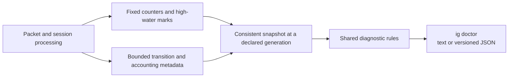

# IronGate session accounting diagnostics

`ig doctor` should make low throughput, unexpected usage totals and high-load degradation distinguishable. A high cumulative byte count and a low current rate are not inherently inconsistent: the measurements may cover different periods or different points in the packet path. Diagnose with aligned observations before assigning a cause. The operator commands and full observation matrix remain planned. The [isolated accounting slice](radius-accounting.md) implements submitted directional counters, bounded RADIUS export, passive status and outage evidence; it does not yet implement runtime `ig doctor`.

## Operator workflow

| Proposed command | Scope |
| --- | --- |
| `ig doctor` | Summary of host, dependencies, enforcement, capacity, accounting lag and observed congestion |
| `ig doctor --client CLIENT` | Resolve one live session and correlate its limits, traffic, accounting and recent changes |
| `ig doctor --client CLIENT --window 60s` | Compare the last 60 seconds of retained observations; report actual coverage and gaps |
| `ig doctor --scope accounting --json` | Machine-readable accounting checks with evidence and finding codes |
| `ig session explain --client CLIENT` | Show effective policy, limit provenance and session transitions |

Default doctor uses read-only queries and bounded observations; it does not create traffic, reset counters, restart the daemon or tune the NIC. Protocol probes and throughput tests require an explicit active verification command. If a client identifier matches multiple sessions, return the candidate session identifiers rather than guessing. Query history by session generation and boot epoch, not only reused IP or MAC addresses.

Include the [network profile and VLAN](vlan-networks.md) in every session key and report. Scope local records and RADIUS export attribution to that network even when destinations are shared. Support `ig doctor --network guest --client CLIENT`; an outage affects profiles that use the failed provider or sink rather than every network globally.

## Counter and rate model

Use `up` for subscriber-to-upstream and `down` for upstream-to-subscriber. Display units explicitly: bits per second for rates and bytes for counters. Distinguish configured bit rates from byte quotas, decimal units from binary units, and application payload from IP or Ethernet accounting. Display the mapping to RADIUS input/output attributes for the selected compatibility profile.

For each direction, expose:

| Measurement | Meaning |
| --- | --- |
| Observed packets and bytes | Traffic seen at the declared subscriber boundary before policy/shaping |
| Allowed packets and bytes | Traffic accepted by access policy |
| Denied packets and bytes | Policy rejections grouped by stable reason |
| Shaper admission, queue occupancy and age | What entered the bounded scheduler and how long it waited |
| Rate-limited, queue-dropped and expired bytes | Separate policing, congestion and scheduling outcomes |
| Submitted packets and bytes | Successful submission to the selected transmit adapter |
| Transmit errors and interface deltas | Adapter failures and host/NIC observations, with attribution limits |
| Accounted packets and bytes | Traffic counted at the explicit configured accounting point |
| Last exported and acknowledged snapshot | The cumulative counters included in each accounting update and its response state |

Submission to a socket or driver does not establish remote delivery or application goodput. Interface counters aggregate traffic and cannot alone prove loss for an individual session. Retransmissions are real network traffic; estimating unique payload requires separate observations and must not silently alter billable counters. If remote observations are unavailable, report delivery/goodput as unverified.

Maintain internal cumulative counters with at least 64-bit width and explicit reset/overflow handling. Define accounting points per compatibility profile, including garden traffic, dropped traffic, retransmissions, headers, and whether counting occurs before or after shaping. Keep diagnostic stage counters distinct from quota and billing counters. Derive quota enforcement and exported accounting from declared counters rather than independently incrementing multiple inconsistent totals.

Compute sampled rates from byte deltas over measured monotonic durations. Compare the same direction, session generation, byte definition and time interval. Do not use lifetime totals divided by a short sample interval or silently bridge a reset, reboot or counter discontinuity. Report the window, last activity, sample age and missing data. Window-average rates can hide short bursts; use bounded queue/high-water observations to explain them.

## Effective limits and bottleneck evidence

Show both configured and effective bandwidth and quota values. For each effective value, identify its source: local TOML, default, RADIUS acceptance, CoA or another explicitly supported override. Show when it changed and the rule that resolved conflicting sources. Distinguish per-session limits from aggregate gateway or upstream constraints, and clarify whether the implementation is policing or queued shaping.

| Symptom | Evidence to collect | Diagnostic limit |
| --- | --- | --- |
| Low rate with high lifetime usage | Aligned recent deltas, session age, activity, units and accounting definition | May be normal; totals alone establish no failure |
| Client slower than expected | Effective limit/source, offered load, queue age, shaper outcomes and transmit rate | Low offered load does not prove a local bottleneck |
| Low throughput with large accounted usage | Policy stage counters, counted drop classes and retransmission evidence if available | Different accounting points may explain the discrepancy without a counter bug |
| Slowdown only at high client counts | Event-loop delay, CPU, active sessions, packet/request pool pressure, queue saturation, NIC drops | Correlation identifies pressure; confirm causality with a controlled experiment |
| Server usage differs from local totals | Same session/window, export snapshot, delay, retry history, backend semantics and units | RADIUS response is not proof that a billing dashboard applied the expected interpretation |
| Usage changes at a reboot or large total | Session identity, boot epoch, counter continuity and low/high-word encoding | Never subtract across unrelated sessions or resets |

Use stable codes such as `throughput.effective_limit`, `accounting.count_point_difference`, `accounting.update_overdue`, `capacity.packet_pool_exhausted` and `diagnostics.insufficient_history`. Attach measured values and the next verification step. Separate confirmed observations, possible explanations and unavailable evidence; doctor must not present a hypothesis as a proven root cause.

## RADIUS accounting observability

Correlate each Start, Interim and Stop with a unique local event record, stable external session identity, cumulative snapshot, scheduling time, attempt times, selected server, response validation result and age. A retransmission is an attempt of an accounting event, not additional subscriber usage. Keep event identity separate from the small on-wire request identifier. Handle encoding and authenticators according to the selected protocol profile.

Record requested versus effective interim interval, timer lateness, accounting request queue occupancy, retries, timeouts, failover, oldest pending update and last validated response. Report local telemetry loss separately from accounting event loss. A retained history ring may discard old diagnostics, but pending accounting obligations need a declared bounded retry/overload policy; never silently evict an unacknowledged Stop. Define shutdown drain, outage and recovery semantics before release.

Export cumulative snapshots with one declared counter interpretation. Handle the low 32-bit octet fields and applicable Gigawords attributes correctly, and test values across the 2^32-byte boundary. Display represented counter values alongside the snapshot identity so support can compare local and exported values without credentials. Validate that retries, late responses, duplicate responses and old session generations do not change usage totals.

Normal validated Accounting-Responses provide protocol-level acknowledgment; an independent backend query is needed to establish what a downstream billing system displays. A future read-only reconciliation adapter may compare records, but doctor must explicitly mark backend ingestion/interpretation unverified until that integration exists.

Protocol references: [RADIUS Accounting](https://www.rfc-editor.org/rfc/rfc2866.html), [RADIUS extensions for interim updates and Gigawords](https://www.rfc-editor.org/rfc/rfc2869.html), and [common RADIUS implementation issues](https://www.rfc-editor.org/rfc/rfc5080.html).

## Bounded observation architecture

Update fixed counters without formatting strings or allocating in the packet loop. Preallocate sample and event capacity; record dropped/evicted observations and the earliest retained time. Never promise arbitrary historical queries. Size per-session snapshots explicitly because observation memory grows with active sessions and retention. Offer aggregate observations plus bounded detail for selected sessions where full detail would exceed the memory budget.

Take coherent snapshots without blocking the owner on a slow CLI reader. Initially copy bounded data at an event-loop boundary; enforce query rate, size and time limits. Account separately for snapshot buffers and operator-process allocation. Session removal and slot reuse must not attach earlier history to a new subscriber. Default reports retain metadata and counters rather than packet payloads or credentials.

## Acceptance cases

- Apply a low RADIUS rate override to a high local rate and verify doctor identifies the effective value and its source.
- Run sustained high offered traffic into a low-rate session; identify queued and dropped traffic and enforce the declared accounting policy.
- Compare idle, bursty and continuously active sessions using aligned windows without falsely diagnosing low offered load as congestion.
- Saturate the packet pool, shaping queues, event loop and request queue independently; each condition has a distinct finding and bounded memory use.
- Delay/drop accounting responses, fail over servers and duplicate replies; usage remains stable while lag/retry evidence changes.
- Verify Start/Interim/Stop and backend reconciliation with a test accounting collector; test inconsistent backend aggregation intentionally.
- Cross the 2^32-byte boundary, simulate a counter reset and reuse a session slot; exports and rate calculations remain correct.
- Change wall time while observing rates, and verify monotonic durations remain correct.
- Evict diagnostic history or issue an oversized/slow query; report incomplete evidence without affecting forwarding.
- Run long sessions and repeated client churn with low bandwidth under high total load; verify stable memory, bounded update delay and diagnosable failures.

Establish numerical latency, capacity and accounting-lag thresholds from the deployment baseline. Make these scenarios release gates rather than relying on manual log interpretation after deployment.

Use the [performance and stability matrix](performance-stability.md) to test low-bandwidth sessions under aggregate saturation, sustained churn and diagnostic query load. Measure doctor overhead and account for time spent taking snapshots. A useful report must not worsen the bottleneck it is diagnosing.
