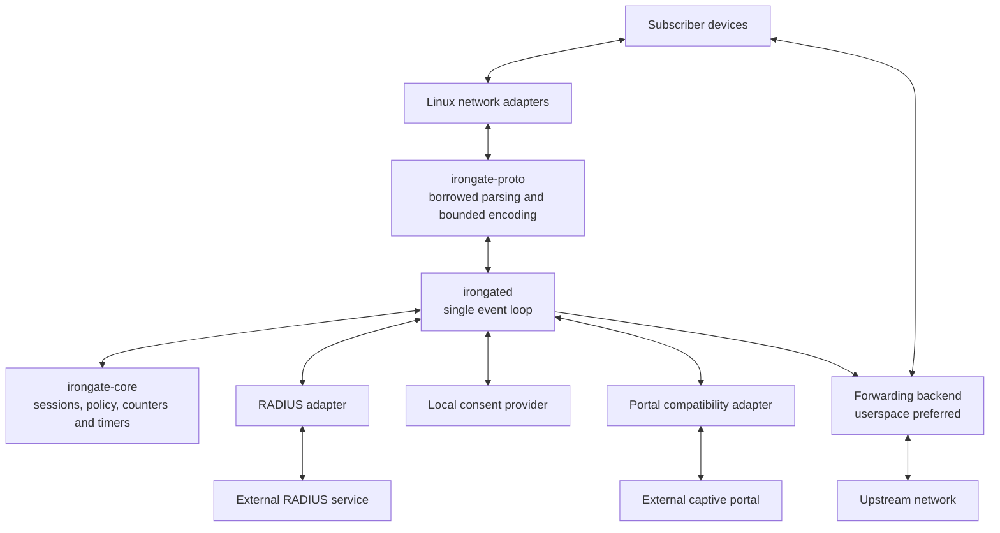
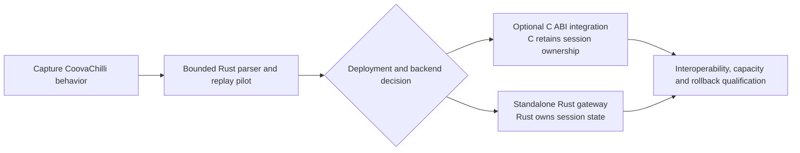
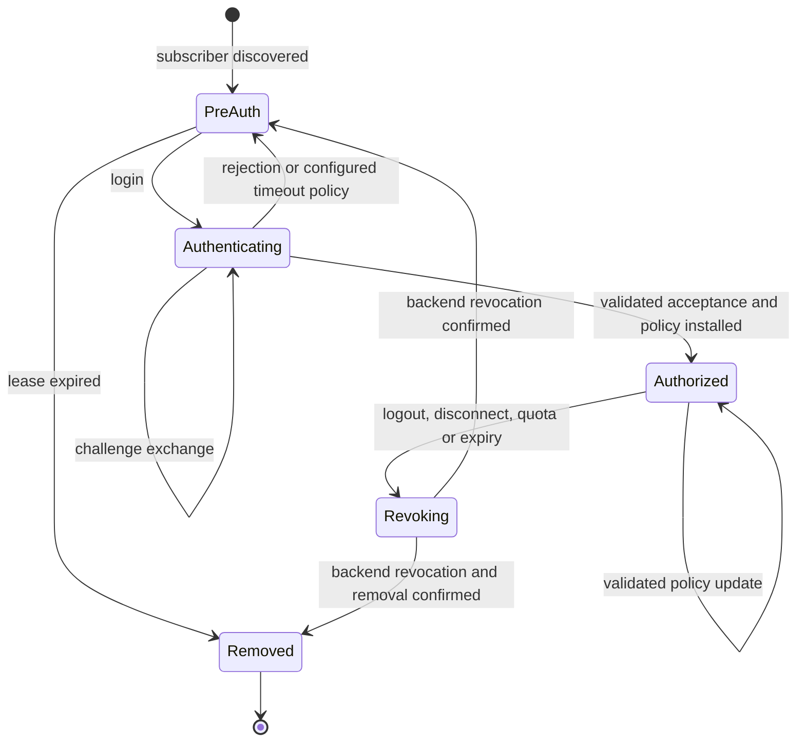

# IronGate architecture

IronGate will provide CoovaChilli's required network access behavior with explicit ownership and bounded memory. Linux is the first platform. Keep protocol, session, policy, accounting, and diagnostic logic in portable userspace modules, with thin platform adapters for packet I/O, clocks, host networking, privileges, and device inspection. Prefer userspace enforcement and forwarding where practical; validate this preference against the deployment's capacity and correctness requirements.

Simple configuration and demonstrable behavior are architectural requirements. One typed configuration should describe deployment intent; adapters translate it into platform operations. A running process is not sufficient evidence of working DHCP, access enforcement, portal login, or RADIUS accounting. See [operations](operations.md) and [NIC tools](nic-tools.md).

Performance and stability are [measured release criteria](performance-stability.md). Establish target packet rates, latency, session capacity and accounting deadlines before selecting optimizations. Bound dispatch work so forwarding pressure cannot starve expiry, revocation, accounting or operator queries. Keep observability interference measurable.

RADIUS is an optional [authentication/accounting provider](authentication-radius.md). Support an initial standalone consent profile and a centralized RADIUS profile through the same policy engine. Keep local credentials/vouchers as a separately scoped extension. [Network profiles](vlan-networks.md) select a portal, provider, accounting sink and limits per VLAN or explicit untagged binding. Session identity includes the network context; host and backend health are reported at both global and affected-profile scope. Use [deployment sizing](deployment-scaling.md) to budget fleet and backend load.

## Ownership and component boundaries

This is a proposed logical architecture. No networking adapters or state engine exist yet. In the preferred userspace path, subscriber frames pass through validation, session policy, accounting, bounded rewriting and queues before transmission. Host routing may still serve the upstream path. A kernel forwarding alternative would bypass ordinary userspace packet evaluation and require policy/counter synchronization; retain it as an explicitly justified backend option.

One event loop owns mutable session state, address ownership, request slots, quotas, and timers. Protocol adapters emit typed events. State transitions produce explicit effects such as changing forwarding policy or sending an accounting request. No packet decision waits for an external service.

Use slot identifiers with generations to reject delayed events for recycled sessions. Keep authentication request correlation separate from subscriber identity. Revocation must invalidate access in the selected backend before reporting successful disconnection. Handle backend errors without falsely marking policy as installed.

## Userspace and platform boundary

| Portable userspace responsibilities | Platform adapter responsibilities |
| --- | --- |
| DHCP and DNS protocol handling; RADIUS and portal contracts | Raw packet and ordinary socket I/O; TUN/TAP integration if selected |
| Session lifecycle, garden policy, quotas and counter definitions | Interface addresses, routes, namespace and link state operations |
| Packet validation, NAT mapping and checksum repair where needed | Driver and NIC capability discovery; OS offload metadata translation |
| Rate eligibility, bounded shaping queues and overload policy | Readiness, monotonic clock and timer wakeups |
| Config validation, diagnostic rules and structured reports | Privileged startup and a minimal host bypass guard |

Avoid exposing Linux descriptors, netlink messages or ioctl structures in core types. Define interfaces as concrete needs emerge rather than building an abstraction for every OS in advance. Platform capabilities are explicit; required but unavailable capabilities prevent readiness. Linux netlink, poll mechanisms and driver details belong in the adapter. Do not add a custom kernel module, eBPF, DPDK or full userspace TCP/IP stack as an initial requirement.

Userspace rate checks alone implement policing. If the product promises shaping, implement bounded queues and scheduled release with per-client/global limits, fair progress and a declared drop policy. Timer and queue memory belong in the deployment budget. Preserve per-session event ordering if profiling later justifies multiple workers.

## Forwarding experiment

| Option | Advantages | Costs and risks |
| --- | --- | --- |
| Port CoovaChilli's userspace packet path | Direct comparison with existing NAT, policy, accounting, and shaping behavior | More custom packet mutation, platform I/O, checksum work, and per-packet CPU |
| Use Linux forwarding, filtering, and shaping | Smaller userspace packet path; use established kernel facilities | Must reconcile kernel policy and counters with session state; backend updates and failure behavior need careful design |

Start with ordinary Linux packet I/O and a single userspace owner. Compare latency, copies, revocation, checksum/fragment correctness, counters, shaping, CPU and resource use against the deployment profile. Introduce batching or memory-mapped rings only when measurements justify them. Treat zero-copy or kernel acceleration as optional optimizations behind the same behavioral contract. Kernel resource consumption needs a separate budget from Rust heap usage.

Userspace policy cannot prevent a parallel host bridge, kernel forwarding path, IPv6 path or external switch from bypassing it. Verify interface ownership and install the minimum persistent host guard needed before becoming ready. Keep unauthorized forwarding blocked during daemon startup, crash and restart; test this behavior rather than assuming it follows from a userspace design. For an IPv4-only release, explicitly contain unsupported IPv6 forwarding on managed subscriber paths while preserving host management access. Account separately for AP/switch isolation that IronGate cannot enforce.

Use explicit ownership for host changes and coexist with network managers through a declared managed or preconfigured mode. Never flush unrelated firewall rules or change arbitrary interfaces. This small dependency on host enforcement is a correctness boundary, not the location of the portable session engine.

## Migration choices

An FFI library is an optional risk-reduction path, not a prerequisite for the standalone daemon. Keep unsafe platform or FFI code in a narrowly scoped adapter crate if it becomes necessary. Existing crates forbid unsafe code. Pointer validity, ownership, panic behavior, and buffer capacity must be explicit in any future ABI contract.

Never run two active engines controlling the same subscriber interface. Use replay or isolated network namespaces for comparisons. Rollback initially means selecting a known build and restarting with documented session loss; live state transfer is outside the first release scope.

## Proposed session model

These states are design concepts rather than a literal translation of DHCP authorization constants. Reauthentication, splash modes, lease retention, and configurable RADIUS timeout allowance require explicit decisions. Default access and failure behavior must be documented and tested for each supported deployment profile.
