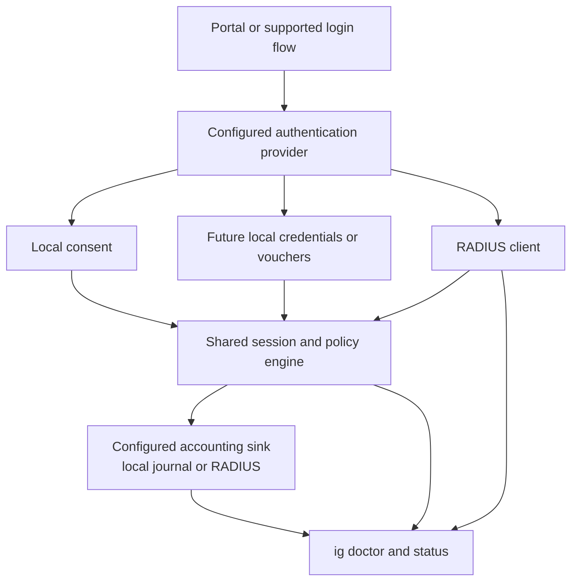

# IronGate authentication providers and RADIUS health

IronGate should be useful without a separate RADIUS installation. Authentication, access policy and accounting are separate responsibilities with explicit configuration and supported combinations. Providers produce typed decisions; the gateway owns session enforcement, counters, quotas and expiry regardless of the identity source. These are proposed features, not implemented capabilities.

The [MVP implementation plan](mvp-plan.md) makes local captive consent the first live demonstration and RADIUS-backed HTTPS login plus accounting the second required gate. The first RADIUS profile uses one explicit backend/method and separate authentication/accounting evidence; broader transport, challenge, failover and dynamic authorization support follows. Existing RADIUS examples select external UAM; a built-in RADIUS login flow will need an explicit schema/configuration increment rather than silently changing that mode's meaning.

## Deployment profiles

| Profile | Required services | Intended behavior |
| --- | --- | --- |
| Standalone consent | IronGate with a small built-in portal and local records | Accept terms and receive the configured local policy; no claim of individual identity verification |
| Standalone credentials or vouchers | Future bounded local provider and credential/voucher store | Authenticate locally without a RADIUS service, using the same session engine |
| Centralized RADIUS | External RADIUS server(s), with the selected portal contract | Central authentication and attributes, accounting and supported dynamic authorization |

Deliver the consent profile first to make an end-to-end gateway usable without another product. Add credentials/vouchers as a separately scoped increment when required. Do not implement a general RADIUS server or reproduce FreeRADIUS policy/database features inside the gateway. A documented external-backend lab can support enterprise interoperability tests without becoming a production dependency for standalone operation.

Local records must include session identifiers, timestamps, policy source, byte/counter definitions and termination reasons. Define bounded retention, export, storage exhaustion and crash semantics; do not describe volatile in-memory counters as durable billing records. Authentication and accounting providers can be configured independently only for combinations that have explicit tests and failure policies.

Local credential checks must use an appropriate vetted password-hashing implementation outside the packet loop with bounded concurrency. Voucher single-use, expiration and cumulative quota state need persistence and atomic redemption before they are reliable across restarts. MAC addresses alone are not strong identity. Do not silently fall back to a local provider or grant access when the configured RADIUS provider fails.

## Provider boundary

The interface carries an attempt identifier, session generation, credential reference or bounded payload, deadline, decision, policy attributes and provenance. Multi-step authentication carries explicit challenge state. A late provider result cannot authorize a different session. Never route packet-by-packet authorization through an external identity service.

## RADIUS configuration

Make the selected provider, endpoint names, transport, source address/NAS identity, authentication and accounting ports, secret references, priority, request capacities, retry/deadline policy and outage behavior visible in TOML and effective configuration. Authentication and accounting may need different destinations; an initial profile can share endpoints, but config validation must reject unsupported separation rather than ignoring it. Explicitly configure CoA/disconnect sources and matching rules when that feature is enabled.

The [RADIUS example](../examples/irongate.toml) illustrates a named primary and secondary and separate authentication/accounting configuration. The [standalone example](../examples/standalone.toml) omits RADIUS entirely. Both pass the implemented static schema checks. Neither is a capacity recommendation or a working server configuration yet; provider/runtime behavior remains unimplemented.

Validation checks provider/sink compatibility, required secrets, bounded capacities, endpoint identity, retry budgets and outage policy. Host preflight shows the chosen source route and local identity; it must distinguish that from server acceptance. Backend onboarding instructions must cover NAS/client registration, source address after NAT, matching secrets, auth methods, vendor attributes, accounting destinations and dynamic authorization reachability. Include a tested backend/version matrix rather than assuming every RADIUS server behaves identically.

## Health evidence

| Health dimension | Evidence | What it does not establish |
| --- | --- | --- |
| Configured | Schema and local preconditions are valid | Server recognizes this NAS or accepts its credentials |
| Transport | Recent exchange or supported transport handshake | Authentication database and account policy work |
| Protocol responsiveness | Recent validated response or explicit supported status probe | Full proxied authentication and billing path work |
| Authentication | Validated outcomes and latency for real attempts | A rejection is a server outage, or every realm/method works |
| Accounting | Last validated response, update age, pending queue, retries and oldest obligation | Downstream billing dashboard reflects the expected totals |
| Dynamic authorization | Listener configuration and validated test or real requests | Every server can reach the listener without an independent test |

Report named endpoints and authentication/accounting separately as healthy, degraded, unavailable, unknown or disabled. Include reason, evidence kind, age, observation window, request rate, timeouts, queue occupancy, RTT percentiles, last validated response, selected server and failover/recovery state. Do not use a single green online indicator to summarize unverified services. In standalone mode, RADIUS is disabled, not an error.

An Access-Reject with valid protocol authentication is a completed authentication decision, not proof of server unavailability. Separate credential/policy rejection from timeouts and invalid-response errors. A timeout can have several causes, including path, registration or secret mismatch; show evidence and next steps without inventing certainty.

`Status-Server` can test the directly contacted RADIUS peer when supported and explicitly enabled per endpoint. It does not prove an entire proxy/backend chain is working, and an unsupported probe must not make an otherwise functioning server appear down. Implement the required authenticator handling and probe rate limits. See [RFC 5997](https://www.rfc-editor.org/rfc/rfc5997.html).

`ig doctor` and `ig radius status` inspect retained observations by default. A proposed `ig radius probe --pool central --server primary --kind status` sends an explicit protocol probe. A future `ig verify --scope radius --test-profile PATH` can test a dedicated authentication/accounting profile with declared side effects. Do not send fake Start/Stop records or synthetic logins during ordinary doctor queries. Keep probe results distinguishable from real user outcomes.

## Failure and recovery

Define policy separately for new authentication attempts, existing authorized sessions, reauthentication, and accounting backpressure. A proposed baseline denies new RADIUS-dependent admissions during an outage while existing sessions retain their already granted policy until normal limits expire. A deployment can require stricter behavior, but the configured consequence must be obvious. Continued accounting is a separate obligation and must have a bounded outage/storage policy.

Use bounded retries, request deadlines, server health hysteresis and limited recovery traffic. Failover must not duplicate usage or attach late replies to recycled sessions. Preserve authentication challenge affinity unless a tested method supports migration. Choose and document accounting destination affinity and replay rules; two servers are not automatically a shared durable accounting database.

## Acceptance criteria

Boot and complete a client session in standalone mode with no RADIUS process or config. Repeat with an explicitly selected RADIUS profile. Exercise reject/challenge, secret mismatch, unregistered NAS, blackholed endpoint, slow backend, unsupported probes, authentication-working/accounting-failing, failover/recovery and concurrent outages. Verify the reported health dimensions, source policy and user-visible behavior for every case.

Test local journal exhaustion and restart semantics before advertising standalone usage records as durable. Re-estimate local credentials, vouchers, additional transports and broader RADIUS methods separately from the consent profile.
