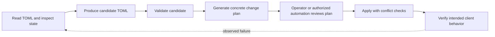

# IronGate configuration and CLI contract

Provide one small command-line interface for operators, shell scripts and AI agents. Readable TOML is the source of desired configuration; the CLI validates, inspects, plans, applies and verifies through shared operations. Automation uses the same commands and evidence as a person. `ig config check` and the first passive `ig doctor` are implemented. Broader interfaces below remain proposals. See [configuration](configuration.md) and [doctor](doctor.md) for exact supported scopes and limits.

Use `ig` as the operator command, with `irongated` as the daemon. The operator binary currently implements config check, local-interface doctor with `--network`, config-free host inventory with `doctor --host`, help and version. Keep one canonical command contract for both people and automation.

## Configuration ownership

Use one explicitly selected, versioned TOML file. Keep common settings short and defaults documented; group advanced settings by purpose. Do not add shell-script configuration layers, implicit environment overlays or a separate writable configuration database. Show the effective configuration and each value's source. Environment variables may help select a config path in the future, but must not silently override policy values.

Keep desired configuration separate from runtime sessions, measurements, plan files and snapshots. Host-specific facts such as driver identity belong in inspection output and preconditions, rather than requiring an operator to repeat them in TOML. Reference secrets by file or an explicit future provider; never print resolved secret values in reports, command lines or plans.

The [example profile](../examples/irongate.toml) illustrates the implemented static schema and capacity knobs. It passes configuration checks but is not a deployment-ready configuration; runtime gateway behavior remains unimplemented. Interfaces, subnet, portal and RADIUS details must be supplied for the actual topology.

Use explicit `[[networks]]` entries for subscriber bindings, per-VLAN portals, provider selection and policy. Named RADIUS pools are shared only by explicit reference. The same schema supports [standalone](../examples/standalone.toml) and [multiple VLAN](../examples/vlan-portals.toml) profiles; no separate hidden per-VLAN config directory is required. Configuration edit paths for named array entries need an unambiguous selector contract before implementation.

## Small command vocabulary

| Command | Effect |
| --- | --- |
| `ig init --output PATH` | Write a commented starter TOML file; refuse to overwrite an existing file |
| `ig config check` | Validate syntax, schema and cross-field rules without probing or mutating the host |
| `ig config show --effective` | Show resolved defaults and field provenance, with secret references redacted as required |
| `ig config set KEY VALUE --output PATH` | Validate and write a candidate TOML change; preserve comments and unrelated fields |
| `ig doctor` | Implemented: passive local interface preflight; broader prerequisites remain planned |
| `ig doctor --host` | Implemented: config-free host interface inventory, active links, driver-reported speed and duplex; text or JSON |
| `ig doctor --client CLIENT --window 60s` | Correlate retained session throughput, limit sources, drops and accounting health over a declared window |
| `ig doctor --scope accounting --json` | Return structured accounting lag, retries, counter interpretation and capacity findings |
| `ig doctor --network guest` | Report readiness, portal/provider selection, capacity and diagnostics for one network profile |
| `ig radius status --json` | Inspect separate authentication/accounting health and failover state per named pool and endpoint |
| `ig radius probe --pool central --server primary --kind status` | Explicit active status probe when supported and configured |
| `ig plan --output PLAN` | Describe required changes and preconditions without applying them |
| `ig apply --plan PLAN` | Revalidate the saved plan and explicitly apply only its declared changes |
| `ig verify --client CLIENT` | Perform explicit active client checks and report their scope and outcomes |
| `ig status` | Report process, enforcement, dependency and capacity state separately |
| `ig session explain --client CLIENT` | Explain session state, limits, pending work and policy decisions |
| `ig nic inspect --interface IFACE` | Inspect Ethernet settings and device capabilities |

Global options include `--config PATH`, `--format text|json`, `--timeout SECONDS` and `--no-color`. Network/session commands accept an explicit `--network NAME` selector and reject ambiguous client matches. `--json` can be a convenience alias for `--format json`. Make noninteractive execution the default. An optional guided setup mode is explicitly selected with `init --interactive`; no other command unexpectedly opens an editor or asks a question.

Tuning plan/apply/restore and bounded support export extend this vocabulary as described in [NIC tools](nic-tools.md) and [operations](operations.md). Avoid unrelated aliases or alternate commands with subtly different behavior. Help text identifies whether each command is read-only, writes a local file, changes the host, or generates test traffic.

Configuration editing writes a candidate file by default. A future explicit in-place mode must preserve file permissions, use conflict detection and an atomic same-filesystem replacement, and report the before/after hash. Reapplying an identical value should produce no change. If comments or unsupported syntax cannot be preserved, fail with an explanation rather than rewriting the entire file. Secret values must not be accepted through positional arguments; this command edits secret references only.

## Human output and structured output

Default text output prioritizes the problem, its evidence and the next action. Machine output is a versioned JSON object on stdout, with diagnostics on stderr. Never mix banners, progress indicators or ANSI colors into JSON. Emit structured failures in JSON mode as well as successes. Bound output size and query duration; truncation and incomplete checks must be visible.

Each response includes a schema version, command, result, completion status, findings and relevant configuration/state identifiers. Schema versions describe output contracts independently of the binary version. Document compatibility rules before automation depends on the interface.

Illustrative doctor result:

```json
{
  "schema_version": 1,
  "command": "doctor",
  "result": "blocked",
  "complete": true,
  "findings": [
    {
      "code": "interface.mtu_mismatch",
      "status": "fail",
      "severity": "error",
      "subject": "enp2s0",
      "observed": 1400,
      "expected": 1500,
      "next_action": "Review the path MTU and generate a plan before changing it."
    }
  ]
}
```

Stable finding codes support rules and scripts; text is for explanation and may improve over time. Findings distinguish pass, fail, warning, unsupported and unverified. An unknown result must not become a pass. Include evidence age and which vantage point produced it for runtime checks. Suggested actions are data, not commands automatically executed by the CLI.

Doctor is passive by default; active protocol or throughput probes require explicit verification commands. See [accounting diagnostics](accounting-diagnostics.md) for session/window identity, counter definitions, retention limits and evidence requirements. It must distinguish confirmed local behavior from unverified remote delivery and backend ingestion.

The current doctor exposes a scoped `checks` array, nested `config` result, evidence source/time and `runtime_verified = false`. It does not implement per-client/windows/accounting scopes yet. Its `complete` field concerns required local interface observations; use [the implemented exit policy](doctor.md) rather than assuming optional unverified probes block an otherwise passing local scope.

## Exit status proposal

| Code | Meaning |
| --- | --- |
| 0 | Command completed and its required conditions passed; informational warnings may remain |
| 1 | Completed check found a blocking condition or failed verification |
| 2 | Invalid invocation or configuration |
| 3 | Permission or required platform capability unavailable |
| 4 | Timeout or incomplete observation |
| 5 | Plan conflict or stale precondition; no further changes applied |
| 6 | Apply failed, including partial changes; inspect the structured action journal |
| 7 | Internal failure |

Optional unsupported diagnostics appear in findings without necessarily failing a command. A missing capability required for the selected deployment blocks readiness. Apply output distinguishes no changes, successful changes, partial application and restoration attempts; a nonzero status does not imply the host was untouched.

## Automation workflow



An example sequence, once these commands exist:

```sh
ig init --output irongate.toml
ig --config irongate.toml config check
ig --config irongate.toml doctor --format json
ig --config irongate.toml plan --output setup-plan.json
ig apply --plan setup-plan.json --format json
ig --config irongate.toml verify --client test-client --format json
```

Scripts branch on exit codes and findings; the sequence above is an illustration, not a shell script that should continue blindly after failure. Mutating a TOML file does not itself reload the daemon or alter host networking. Generating a plan does not authorize applying it.

Plans bind the configuration hash, host/device identity, relevant observed-state hashes, schema/backend version and each intended effect. Reject mismatches before mutation. Serialize conflicting changes. Record each applied operation and its result so interrupted or partial application can be diagnosed. Retry only operations with defined idempotency; do not assume hardware changes or RADIUS requests are safe to repeat. Configuration installation and daemon reload require an explicit plan action.

## AI agent use

The CLI should be sufficient for an agent to inspect state, collect evidence, draft a configuration correction, generate a change plan, and verify a separately authorized application. No special agent-only control plane is required initially. A future API or tool server should wrap the same operations and contracts.

Read-only inspection should work with minimal privileges and clearly report unavailable evidence. Mutating operations use a narrow privileged boundary and cannot silently escalate permissions. Keep structured action targets within the declared managed resources. Redact secrets and bound history, report sizes and operation deadlines.

Treat logs, DHCP hostnames, RADIUS attributes, portal responses and other client-controlled strings as untrusted data in reports. They may contain arbitrary text and are not instructions or authority to change configuration. Use typed action identifiers and explicit arguments instead of executable shell snippets as the automation contract.

Acceptance tests should run the CLI without a terminal, cover JSON parseability and stable codes, verify stdin/stdout/stderr separation, exercise invalid TOML and stale plans, preserve comments during edits, prove read-only commands do not mutate state, and verify partial-application reporting. Mock platform adapters should make these cases reproducible without privileged networking.
