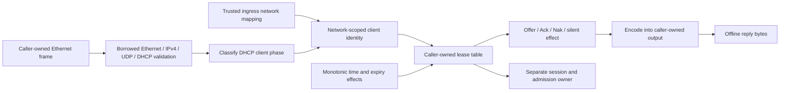

# Offline lease foundation

`feature/lease-core` adds bounded direct-client DHCP ownership in `irongate-core` and ACK/NAK encoding in `irongate-proto`. Run the complete synthetic exchange on this PC with:

```sh
just lease-demo
```

It demonstrates DISCOVER → OFFER → REQUEST → ACK, renewal, release, a new offer, DECLINE and quarantine expiry. It opens no sockets and changes no interfaces, addresses, routes or firewall rules. The daemon still does not serve DHCP. This is the lease portion of M1, not a completed portal/session engine or the live M2 lab.

## Ownership and packet path



The critical state-changing work is in [`lease/table.rs`](../crates/irongate-core/src/lease/table.rs), [`lease/requests.rs`](../crates/irongate-core/src/lease/requests.rs) and [`lease/maintenance.rs`](../crates/irongate-core/src/lease/maintenance.rs). Protocol classification and shared reply writing are separate small modules in [`dhcp`](../crates/irongate-proto/src/dhcp). `lib.rs` remains a short entry point.

The core borrows `&mut [Slot]` with exactly one slot per allocatable address. Storage is selected and created by its owner at startup, and never grows. No allocator, OS clock, socket or platform API is imported. Both libraries remain `no_std` and forbid unsafe code. There are no new third-party crates; the protocol crate uses the core only as an internal development dependency for examples/tests.

## Explicit bounds and identities

| Resource | Current contract |
| --- | --- |
| Addresses | One contiguous IPv4 pool per table, 1–256 slots; prefix 1–30; exclude subnet/broadcast/server addresses |
| Client identity | Complete option 61 when supplied, otherwise Ethernet chaddr; opaque IDs are 2–255 bytes, stored inline |
| Network | Owner-assigned `NetworkId`, supplied from a trusted receiving interface/VLAN mapping |
| Lookup | Address lookup is indexed; identity lookup and expiry scans are linear, bounded by 256 |
| Internal handle | Network, owner-assigned arena epoch, slot index and generation |
| Generation | Increments on reservation after reuse; never wraps; exhausted generation retires the slot |
| Clock | Owner-supplied nondecreasing monotonic seconds; checked deadline arithmetic |
| Events | Caller-supplied cells; insufficient capacity rejects the whole time advance without changing clock or state |

Arena epochs must be distinct across construction/reload. A restart must invalidate old asynchronous work; assigning epoch `1` in the synthetic example is not a restart/recovery strategy. Generations prevent stale **internal** handles resolving after slot reuse. They are not present on the DHCP wire and cannot authenticate a delayed/spoofed client message. MACs and option 61 are client claims, not credentials.

The 256-address cap is a pilot work bound, not a production scaling claim. Inline full-length identities trade predictable storage for a larger slot. Budget actual `size_of::<Slot>()`, event cells and buffers for the target build; do not infer a fixed ABI or memory use from field sizes alone. The existing TOML schema's larger capacities are not wired to this runtime; a future adapter must reject unsupported configurations explicitly.

## State transitions and effects

| Input | Behavior |
| --- | --- |
| DISCOVER | Reuse this client's current address, honor an available address hint, or reserve a free slot; exhaustion is explicit and never evicts another binding |
| Repeated DISCOVER | Same transaction does not extend the reservation; rediscovery preserves a bound lease and reports its remaining lifetime |
| SELECTING REQUEST | Our server/address plus current offer transaction binds the lease; duplicate ACK uses remaining lifetime; stale/unmatched selection gets a NAK |
| Selection of another server | Silent; remove only the matching pending offer, preserving any active binding |
| INIT-REBOOT / renewal / rebinding | ACK a matching known binding; NAK a wrong subnet or known address mismatch; stay silent for an unknown binding on the correct subnet |
| RELEASE | Matching owner/server can free a bound address; no DHCP reply |
| DECLINE | Matching owner/server can quarantine an offered/bound address; no DHCP reply |
| Time advance | Return offer/binding/pending-offer/quarantine expiry effects; clear only expired ownership or pending state |

Call `advance(now, events)` and consume `events[..count]` **before** applying commands at that time or reusing addresses. On success only that prefix contains new events; trailing cells may retain old contents. The owner must also consume RELEASE/DECLINE effects before dependent session state can survive address reuse. The table does not run callbacks, revoke access or persist events itself.

A bound lease establishes address ownership only. It never grants upstream access. The [session/admission foundation](session-core.md) now correlates consent and retained policy effects with the lease generation. Actual policy application, the portal service, accounting and live revocation remain unimplemented.

## Wire behavior

`RequestFrame::lease_message()` checks that Ethernet source matches chaddr and IPv4 source matches ciaddr, then classifies consistent option 50/54/ciaddr combinations. The raw structural parser remains separately usable, so structurally parsed input is not automatically an acceptable lease command. INFORM is structurally parsed but explicitly unsupported by this lease slice. Neither classifier chooses a trusted network from client-supplied data.

The original broadcast-only OFFER API remains byte-compatible with its existing fixtures. ACK honors the initial broadcast flag, using direct client MAC/assigned-IP unicast when clear; renewal ACK unicasts to ciaddr. NAK always broadcasts, clears ciaddr/yiaddr, and carries no lease, mask, router or DNS options. Replies echo client identifier and inline VLAN TCI and compute software IPv4/UDP checksums. All encoder errors leave output unchanged. Subnet/router/DNS deployment policy remains the caller's responsibility.

The fixture adapter in `examples/support/lease.rs` is assertion-based offline wiring. A live adapter must validate configuration and reserve output/effect capacity before changing ownership, report failures without panicking, and define failed-transmit behavior. Relays, active ARP conflict checks, durable leases/recovery, DHCP INFORM service, lease-time negotiation and broad option support remain outside this increment. A client-reported DECLINE quarantine is not active conflict detection.

Protocol rules follow [RFC 2131](https://www.rfc-editor.org/rfc/rfc2131.html), with client identifier echo from [RFC 6842](https://www.rfc-editor.org/rfc/rfc6842.html). These explicit limits do not claim full DHCP conformance or client interoperability.

## Verification and measured limits

```sh
just check
just comparison-check
just lease-demo
just lease-allocations        # Optional system Valgrind
just coova-compare --checks-only
```

Regression tests cover lifecycle deadlines, stale transactions/handles, epoch/network separation, identity namespaces, pool exhaustion, quarantine, checked clocks, generation retirement and atomic rejection of undersized expiry output. An exact 256-slot test checks unique addresses, exhaustion without eviction and complete expiry delivery. Independent Python-generated wire fixtures cover initial/unicast/renewal ACK and NAK, VLAN/client-ID echo, release/decline and reboot classification. They are synthetic, not captures or evidence of real clients working.

The release `lease_replay` example performs identical setup/warmup in two processes, then zero versus 100000 extra lifecycles. Each includes parse/classify, identity construction, offer, bind/ACK, renewal/ACK, release, rediscovery, decline and expiry consumption. The initial PC run reported **43 allocations, 41 frees and 9946 total allocated bytes in both processes**: zero additional measured heap allocation during this workload. This includes startup fixture decoding/storage and runtime overhead. It is not a throughput benchmark, all-input allocation proof, large-deployment qualification or RSS/kernel-memory guarantee.

The existing C/Rust framework still compares only option/OFFER helpers: 22 cases, with documented differences and clean ASan/UBSan execution. ACK/NAK and lease behavior currently have independent Rust fixture/state tests, not equivalent original C state-machine comparisons. Add those suites when the relevant C service boundaries are explicitly isolated; do not report the existing helper comparison as full DHCP equivalence.

## Next increment

The independent [session/admission owner](session-core.md) is now implemented and tested offline with a simulated worker. Next add a thin Linux adapter in the disposable VM, first for one untagged DHCP client plus ARP. Keep the VM's external NIC disconnected and create the client links inside the guest. Prove real DHCP interoperability, unauthorized-drop and revocation/crash guards before connecting the local consent portal. See the [MVP plan](mvp-plan.md) and [VM boundaries](vm-demo.md).
