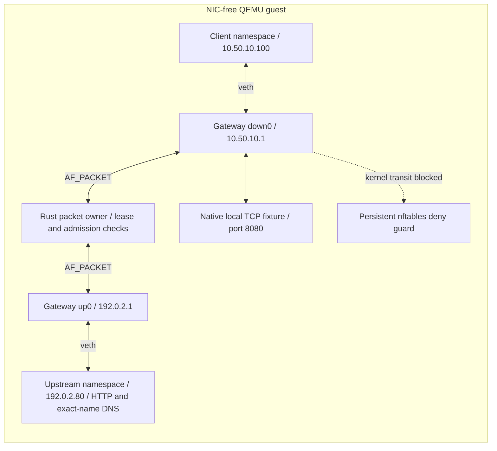

# Linux packet lab: first live gateway path

`feature/linux-packet-lab` connects the lease/session foundations to real Ethernet packets in a disposable QEMU guest. An independent BusyBox DHCP client obtains `10.50.10.100`, receives userspace ARP replies, reaches a native local HTTP fixture, and can reach a routed origin only after explicit test consent. Logout, access expiry and daemon death block both existing and new client TCP traffic.

This is a one-client, untagged IPv4 experiment. The normal daemon still has no deployable gateway/configuration mode. The local HTTP page is a connectivity fixture, **not a consent portal**; admission currently uses a root-owned guest-only test control socket. RADIUS, accounting, cloud handoff, VLANs and production qualification remain pending.

## Run and learn

```sh
just vm-lab-check          # Host-side contract tests; no VM or network changes
just vm-lab-prepare        # One-time separate package image; temporary userspace NAT
just vm-lab-command        # Print the NIC-free QEMU command, without starting it
just vm-lab-test           # Build static Rust binary; fresh overlay; execute and shut down
```

Host requirements are the existing QEMU/KVM, `qemu-img`, `cloud-localds`, Python and Rust tools, plus the installed `x86_64-unknown-linux-musl` target. KVM must be accessible to the invoking process; an agent sandbox may require execution outside it. No host root, TAP, bridge, routing, firewall, sysctl or NIC changes are made. The existing `target/vm/learn` learning disk is not modified.

Preparation boots a **separate** disk backed by the pinned Debian base and installs `iproute2`, `nftables`, BusyBox, `ethtool` and Python inside it. Only that preparation boot has QEMU userspace NAT, with no host bridge. Package versions and the prepared disk SHA-256 are retained. The prepared disk becomes read-only; tests use fresh overlays and explicitly start with `-nic none`. Package selection is recorded, not a promise that a future apt repository will supply identical versions; reuse the verified prepared image for repeatable local runs.

The Debian cloud kernel lacks 9p filesystem support. Instead, binaries/scripts are encoded into the read-only NoCloud seed and written inside the guest by cloud-init. No host directory is shared. `-serial stdio` is redirected to a per-run log, `-monitor none` disables the interactive monitor for automation, and the guest powers itself off after the result. No console password is needed for this automated run. The original [interactive first-boot lesson](qemu-first-boot.md) remains available separately.

## Guest topology and enforcement



All veths, namespaces, addresses, routes, sysctls and nftables changes belong to the guest. The harness refuses preexisting owned namespace names, records what it creates, and deletes only those namespaces during teardown. The management namespace must initially contain only loopback. Reports retain distinct network-namespace identities and cleanup errors; incomplete or contradictory evidence cannot pass.

The gateway's kernel forwarding starts disabled. An owned `inet ig_lab` table has default-drop input, output and forward policies, with narrow input/output exceptions for the native local TCP fixture. The Rust owner transmits authorized routed frames directly through packet sockets; it does not open kernel forwarding with an nftables allow rule. Thus **userspace owns ordinary admission decisions; nftables provides the independent persistent kernel-bypass guard**. Kernel ARP replies on gateway interfaces are disabled so ARP reachability exercises Rust. IPv6 starts disabled in the owned namespaces. The expanded acceptance suite tests rejection and kernel guarding even when it is deliberately enabled; supported IPv6 transit remains unimplemented.

Before the crash check, the harness installs permanent lab neighbor entries and then kills only the recorded IronGate executable. It deliberately enables kernel IPv4 forwarding in the gateway namespace. Existing and fresh TCP still fail, and the retained nftables forward-drop counter must increase. This separates guard evidence from missing ARP, absent routes or the earlier `ip_forward=0` setting. The fault injection disappears when the owned namespace is deleted.

## Critical code and memory boundary

| Module | Responsibility |
| --- | --- |
| [`lab/profile.rs`](../crates/irongated/src/lab/profile.rs) | Explicit fixed MAC/IP peers, one lease/session and five-second test admission |
| [`lab/io.rs`](../crates/irongated/src/lab/io.rs) | Guest/run/namespace checks, inherited descriptors, readiness and bounded control/data budgets |
| [`lab/packet.rs`](../crates/irongated/src/lab/packet.rs) | Peer classification, DHCP/ARP dispatch, current authorization before output submission |
| [`lab/dhcp.rs`](../crates/irongated/src/lab/dhcp.rs) | Borrowed client commands, bounded lease decisions, ACK-to-session attachment and cleanup |
| [`lab/state.rs`](../crates/irongated/src/lab/state.rs) | Single-owner clocks, actual userspace policy cell and exact policy acknowledgements |
| [`arp.rs`](../crates/irongate-proto/src/arp.rs) | Reply only for the configured gateway IP and expected peer; no neighbor cache |
| [`routed.rs`](../crates/irongate-proto/src/routed.rs) | Exact route/identity checks, fixed IPv4/transport bounds, TTL decrement and IP checksum repair |

The guest supervisor binds two nonblocking AF_PACKET sockets and passes them through stdin/stdout. Rust safely clones those descriptors and uses `rustix` only for readiness polling. No IronGate unsafe code, raw syscall binding, async runtime or userspace TCP stack is added. The Linux active `rustix` dependency graph adds only `bitflags` and `linux-raw-sys`; see [the dependency review](dependencies.md).

Readiness processing reserves control progress before at most 64 packets from each side per turn. Each turn advances monotonic lease/session time, consumes expiry effects and applies retained policy work. Applying policy writes a fixed userspace cell for the exact session/lease/deadline before acknowledging it. Each transit packet checks that cell **and** the current session/lease decision. Removal clears only its matching generation. No formatting/logging is done per packet; JSON/control work is outside packet dispatch.

Buffers and lease/session cells are startup-owned. Borrowed parsing avoids packet collections; routing makes one bounded copy into caller-owned output to rewrite Ethernet/TTL/checksum. This is not a zero-copy forwarding claim. `WouldBlock`/failed output submissions are counted and dropped without growing a queue. Forwarded IP-octet counters mean successful submission to the packet descriptor, not billing records or proof of NIC wire delivery. Live allocation/RSS, saturation behavior and throughput remain unmeasured for this new adapter; the earlier offline allocation evidence retains its narrower scope.

The profile accepts one untagged direct-client IPv4 pool and one exact upstream IP/next-hop MAC. No NAT, fragments, IPv4 options, dynamic neighbor learning, general routes, DHCP relays, TLS, general DNS proxy or ICMP error generation is implemented. The upstream fixture answers only the tested `origin.test` A query. MAC/IP consistency is checked against this explicit lab profile; this is not broad spoofing or multi-client isolation qualification. NIC offloads are disabled on the guest veth endpoints for reliable software-checksum observation. Physical NIC configuration is untouched.

## Evidence and open qualification

The initial seven live scenarios passed in fresh overlays: independent DHCP, userspace ARP/native local TCP, unauthorized-drop, admitted bidirectional TCP/DNS, logout on existing/new TCP, expiry on existing/new TCP, and crash guarding with kernel routing/known neighbors. The final pre-commit development run was `98228b16440eaced54eda471c356c998`, with six independently counted kernel forward drops during the crash test and no cleanup errors. Earlier failed boot/scenario logs were retained rather than overwritten as passes.

The [expanded acceptance suite](lab-acceptance.md) now adds authorized MAC/IP spoof checks, userspace IPv6 rejection and a dedicated IPv6 kernel-guard fault injection, for eleven cases. It uses schema 2 and records the versioned target profile plus an explicit `not_run` scale-qualification status. Historical schema-1 results retain their original seven-case scope.

Each run writes `target/vm/packet-lab/runs/RUN_ID/report.json`, `serial.log`, the exact QEMU command, private seed and overlay. Reports record commit/dirty status, binary/lockfile/harness hashes, target/profile, compiler/QEMU/kernel versions, base/prepared-image identity, guest package versions, resource settings, topology/guard observations, client lease, case outcomes and bounded diagnostics. JSON is the canonical status; the host validates exact run identity, all eleven named passing cases, no external NIC, separate namespaces, exercised guard and successful cleanup. These local artifacts are not the permanent release archive.

The development checkpoint passed **122 Rust tests**, 16 comparison-framework tests and 10 host-only lab-contract tests. New tests include independent ARP/routed wire fixtures, truncated/short-output/spoof/TTL/fragment checks, actual nonblocking local datagram dispatch, submission-error counters, DHCP bridge lifecycle and daemon startup refusal outside the owned guest. Local Unix datagram tests do not configure host networking. VM evidence complements them; it is not imported into ordinary LCOV.

The initial coverage-backed CRAP report covered **211 functions across 54 matched source/LCOV files**. Two exceed 30: the existing CLI parser (39.32) and the new live `io::run` entry (207.02, about 13% ordinary-test line coverage). The latter executes in QEMU, but those execution counts are not collected by `just crap`; improving startup structure and collecting guest coverage are open pre-launch qualification tasks. The subsequent [startup/acceptance work](lab-acceptance.md) resolves the startup threshold finding: shared owner-turn and descriptor validation now have 100% ordinary-test line coverage. The CLI parser remains open; uncollected guest bootstrap/serving coverage is still explicit. Complete reports remain under `target/quality/`; see [release evidence](release-evidence.md).

No packet-rate, latency, soak, multi-client capacity or hardware-performance claim follows from these smoke tests. Use the frozen numerical acceptance profile and add load/failure evidence before promoting this backend. The next product feature is the local consent portal through the same admission owner, followed by RADIUS authentication/accounting and then external/cloud handoff. A placeholder HTTP page and root-only test consent are not Gate A.
