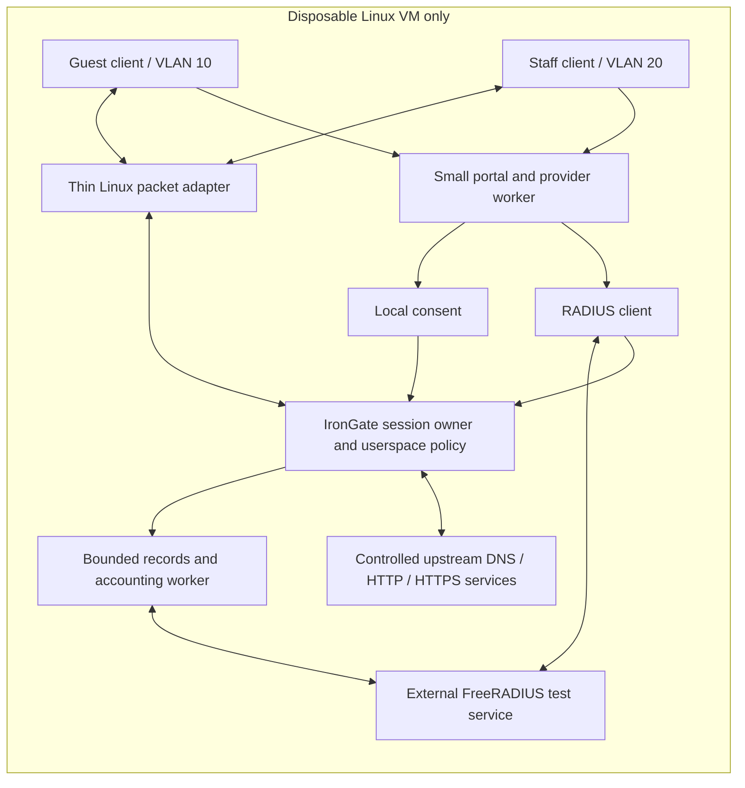

# Captive portal MVP: roadmap and implementation plan

The MVP is a repeatable demonstration of enforced captive access, followed by the same flow using an external RADIUS service. A portal page alone is not the outcome: an independent client must be blocked before admission, receive access after admission, and lose it on logout or expiry. RADIUS authentication and accounting are the second required acceptance gate, not an optional item left until after the MVP.

This is the implementation plan. Configuration validation, passive host diagnostics, offline DHCP parsing/replies, bounded lease and consent/admission ownership with simulated policy effects, the offline C/Rust comparison, and a verified NIC-free QEMU first boot exist today. A separate [guest-only packet lab](linux-packet-lab.md) now implements real DHCP/ARP and gated routed transit with native-service reachability and logout/expiry/crash guards. The [local consent portal](local-consent-portal.md) now implements the browser/API boundary in that isolated lab. The RADIUS client and deployable gateway remain pending. The priorities here govern implementation order; the broader production scope remains in [architecture](architecture.md) and [compatibility](coova-compatibility.md).

## The demonstrations we will work backward from

| Gate | Demonstration | Evidence required |
| --- | --- | --- |
| A: local captive portal | A fresh client acquires an address, opens the consent page, accepts terms, reaches an upstream test service, then logs out | Before/after client probes, session transition events, policy installation/revocation outcomes, local records and counters all identify the same network/session |
| B: RADIUS captive portal | The same portal offers HTTPS login against a configured RADIUS service; valid credentials grant access and rejected credentials do not | Validated Access-Accept/Reject, server identity/latency, applied supported attributes, Start/Interim/Stop with matching session ID and acknowledged accounting |
| C: MVP release candidate | Two VLANs use different portal content/policies, including local and simulated external/cloud hosting, with standalone and RADIUS profiles tested independently and together | Same-MAC sessions on separate networks remain independent; wrong-tenant/device/network and stale callbacks fail; overload and backend failures remain bounded and diagnosable |

The first walkthrough may use a documented portal URL inside the client VM. It must demonstrate real traffic enforcement, not simulate access with a browser flag. HTTPS interception, universally automatic OS popup detection and arbitrary external UAM compatibility are not prerequisites for Gate A. For Gate B, credentials must travel over a correctly validated HTTPS connection; the test CA is trusted only by lab clients, without changing this development PC's trust store.

RADIUS is a client integration with an existing service, initially a pinned FreeRADIUS lab instance. IronGate will not implement a RADIUS server or credential database. Standalone consent remains available without that service and does not claim to verify a person's identity.

## Walkthrough and dependencies

1. Start the disposable lab from a known snapshot and validate its TOML.
2. Start IronGate with bounded storage and deny-by-default enforcement; readiness stays false until required effects succeed.
3. A fresh client obtains a lease and resolves the explicitly permitted lab names.
4. An upstream probe fails before admission. The client can reach only the declared bootstrap services and portal.
5. The user accepts terms, or logs in through the RADIUS profile. The attempt is bound to network, session generation and deadline.
6. Reserve accounting/admission capacity, apply the provider decision and forwarding policy, and confirm access only after the required effects succeed.
7. An independent client probe reaches the upstream service. CLI evidence shows the applied policy source, traffic counters and accounting state.
8. Logout or expiry removes access immediately without waiting for an accounting response. A Stop event and reason are retained according to the declared record policy.
9. Repeat with backend loss, stale callbacks, full pools and a second VLAN. Inspect the same evidence from text and JSON output.

Working backward, the page depends on a provider/admission API; admission depends on generation-safe sessions and enforceable policy; sessions depend on bounded address ownership and packet classification; the entire demonstration depends on an isolated test network and working return traffic. Build these dependencies in that order before polishing portal appearance.

No physical NICs, host LAN bridges or host firewall changes are required. Routing, namespaces, addresses, test certificates and services belong inside the disposable VM. Initial upstream traffic terminates at controlled services in that VM; this proves forwarding and access control without claiming public Internet/NAT support. A real client network stack and browser are required for the walkthrough, alongside scripted clients for regression checks.

The concrete [VM proposal](vm-demo.md) uses one QEMU/KVM Debian guest with all test links inside it, including a separate HTTPS service as a cloud portal stand-in. [Portal hosting](portal-hosting.md) is selected per network and must remain independent of provider choice. Test tenant isolation against this repeatable service before using a real hosted portal; a full multitenant SaaS application is not part of the gateway MVP.

## MVP boundary and technical choices

| Area | Initial implementation decision |
| --- | --- |
| Platform | Linux lab; portable parsing, sessions, policy and accounting logic; thin packet/clock/device adapters |
| Forwarding | Prefer a bounded userspace path with a routed lab upstream and explicit return route; no NAT required for the first demo |
| Backend decision | Prove unauthorized-drop, authorized-forward and revocation behavior before committing to a packet I/O design. If userspace cannot meet the agreed profile, document and test a distinct backend choice rather than silently moving enforcement into Linux |
| Host protection | A minimal adapter-owned persistent guard prevents kernel/bridge/IPv6 bypass and remains deny-by-default on process death; installation/verification is part of readiness |
| Bootstrap | Direct Ethernet DHCP DORA plus renewal/release/decline/expiry, bounded leases, ARP and bounded neighbor handling; one untagged profile first, then two single-tag VLANs |
| DNS | A bounded DNS service/proxy with explicit pre-admission allowlist and deadlines; no all-domain spoofing assumption |
| Portal | Small built-in page; native OS TCP services outside the packet loop. Begin with manual URL discovery; use an established bounded HTTP parser/server rather than building a TCP stack |
| Portal placement | Explicit local/external selection per network; external tenant/site/gateway scope and an authenticated, versioned handoff contract. No implicit fallback between placements |
| HTTPS/discovery | Select a vetted TLS component before credential entry. CAPPORT discovery and a defined HTTP redirect path are later increments; the API requires HTTPS and DHCP option 114 advertises the API endpoint, not an arbitrary login page |
| Sessions | Startup-owned slots and indexes; network identity plus generation; one owner for admission, expiry, counters and effects |
| Providers | Local consent first; a narrow RADIUS login method next through the same typed attempt/decision interface |
| Records | Bounded local event journal/worker for standalone mode; explicit queue/disk-full behavior and clean/crash semantics. Volatile counters are not durable billing records |
| Configuration | Readable TOML, strict supported-feature validation, explicit lab profiles. Existing example files are schema illustrations, not working deployment instructions |

Local portal services and packet forwarding must not create parallel paths that bypass policy. The packet-adapter experiment must prove how native TCP services are reached while unauthorized transit stays blocked, how return traffic maps to the correct session, and how restart/crash closes access. Reject IP/MAC spoofing inconsistent with the bound lease/network before transit; unknown profiles and unsupported IPv6 transit stay blocked. These are implementation tasks, not assumptions that a VM or userspace design automatically satisfies.

An initial manually opened consent page can use HTTP within the isolated lab; it handles no passwords. Broad automatic portal detection is separate work. CAPPORT's HTTPS requirements and discovery semantics are defined in [RFC 8908](https://www.rfc-editor.org/rfc/rfc8908.html) and [RFC 8910](https://www.rfc-editor.org/rfc/rfc8910.html). We will not redirect or impersonate arbitrary HTTPS sites.

## Implementation sequence and reviewable feature branches

Each increment should produce a runnable artifact and its own evidence before growing the next subsystem. Branches below describe the intended increments. The protocol checkpoint is merged into `release/0.1.x`; `feature/lease-core` is merged into that release branch. `feature/session-core` implements offline consent/admission ownership and its bounded effects with a simulated policy worker; the [Linux packet lab](linux-packet-lab.md) now supplies a narrow real M2 enforcement path on `feature/linux-packet-lab`. Broader protocol/interoperability and load qualification remain pending. Integrate completed increments through `release/0.1.x` as requested rather than developing an enormous long-lived feature branch.

| Step / proposed branch | Concrete work and module boundary | Exit evidence | Rough effort |
| --- | --- | --- | --- |
| M0 `feature/demo-contract` | Freeze lab profile/acceptance scenarios, VM resource ownership/cleanup and protocol/backend contracts; retain the comparison framework | Reproducible topology design, explicit supported inputs and selected numerical goals; no host-network changes | 1–2 engineer-weeks |
| M1 `feature/lease-core` and `feature/session-core` | `irongate-core`: lease/address ownership, network/session keys, generations, timers, pending effects and capacity errors. `irongate-proto`: ACK/NAK and DHCP state-relevant input beyond the OFFER pilot | DORA/renew/release/decline/expiry fixtures, pool exhaustion, slot reuse and stale-event tests; zero measured designated-path allocation | 2–3 engineer-weeks |
| M2 `feature/linux-packet-lab` | Thin Linux adapter, bounded packet/neighbor pools, ARP, routed userspace forwarding, explicit ingress identity and host guard. Select the smallest necessary I/O/HTTP dependencies after review | Actual client obtains a lease; unauthorized transit blocked; test authorization permits bidirectional transit; revoke/crash/IPv6/spoof tests pass inside VM | 2–4 engineer-weeks |
| M3 `feature/consent-portal` | Portal worker with bounded requests/timeouts, consent provider, generation-bound one-use admission token, local records, status/doctor evidence and logout | Gate A walkthrough and automated equivalent; duplicate/expired/wrong-network actions rejected; full record queue denies new admissions clearly | 1–2 engineer-weeks |
| M4 `feature/radius-provider` | Explicit built-in RADIUS-login schema increment, HTTPS login, bounded requests/deadlines, response verification, supported policy attributes, accounting worker and separate auth/accounting health | Gate B with accept/reject/timeout/invalid response, matching Start/Interim/Stop, secret/NAS onboarding guide and accounting-only outage diagnosis | 2–4 engineer-weeks |
| M4b `feature/external-portal` | Freeze the UAM/native protocol boundary, scoped handoff and callback validation, exact pre-admission garden, and a separate HTTPS multitenant portal fixture | Local and external placement coexist; wrong-tenant/device/network, replay, stale session, redirect/garden and cloud outage tests pass without direct state manipulation | 1–3 engineer-weeks |
| M5 `feature/mvp-qualification` | Two VLANs with distinct content/policy, reproducible demo setup/teardown, configuration/diagnostic polish, load/churn and failure regression scenarios | Gate C; saved evidence for both providers, isolation, bounded overload, low-rate/high-load accounting and crash/restart behavior | 2–3 engineer-weeks |

The total planning range is approximately **11–21 engineer-weeks** from this checkpoint for a controlled lab MVP, including the external portal fixture/contract increment, assuming an experienced Rust/networking engineer and a viable ordinary Linux userspace packet path. Gate A is approximately 6–11 of those weeks. These are unvalidated planning ranges, not calendar commitments or a production estimate; revisit after M0 and the M2 forwarding experiment. The broader replacement remains the larger effort described in the roadmap. VM automation, TLS/backend dependency fit, browser/cloud handoff behavior, DHCP interoperability and counter/revocation correctness are material uncertainties.

Do not build new abstractions or crates solely to match this table. Keep `lib.rs`/`main.rs` as wiring; split related code into focused modules such as `lease`, `session`, `timer`, `policy`, `effects`, `portal`, `radius` and `accounting` when their implementation warrants it. Packet/session modules stay allocator-independent. Operator/HTTP/TLS/journal workers may allocate within explicit bounds and must not block the packet owner. Proven third-party components are preferable where they remove protocol/crypto risk; review actual features and memory behavior before adding them.

## RADIUS implementation contract

Use one named authentication/accounting endpoint in the first live lab profile. Keep the schema's larger pool model, but reject or clearly mark unimplemented failover/transport features rather than claiming they work. PAP with dedicated lab credentials is the proposed first login method; credential submission requires validated portal HTTPS. UDP is initially limited to the isolated lab profile. Review protected transport requirements before any real deployment; no production approval follows from the UDP demo.

Implement packet/attribute bounds, secure request authenticators, Response-Authenticator and strict Message-Authenticator handling for the agreed UDP profile, source/identifier matching, bounded retry/deadline policy, duplicate/late reply rejection and generation-safe completion. Use vetted randomness, MD5/HMAC and TLS libraries; do not invent cryptography. Pin the lab backend version and enforce modern client/server policy, including the relevant [FreeRADIUS client security settings](https://github.com/FreeRADIUS/freeradius-server/blob/master/raddb/clients.conf). Additional transports have different authenticator rules and require their own profile/tests.

Start with Access-Accept/Reject and Session-Timeout/Idle-Timeout, plus an explicitly supported Acct-Interim-Interval override. Access-Challenge must produce a clear unsupported result without granting access until a tested challenge flow is implemented. A valid reject is a completed decision, not an outage. Missing/invalid authenticators and unexpected sources must not update healthy-response evidence. Unsupported mandatory policy attributes must not silently result in unrestricted access; retain effective-policy provenance and diagnose what could not be applied.

Accounting needs one stable Acct-Session-Id, declared NAS-relative input/output directions, 64-bit internal counters, interoperable octet/gigaword encoding, and explicit Start/Interim/Stop lifecycle. Reserve event capacity before admitting a session; coalesce only replaceable observations, preserving critical start/stop obligations within the declared outage bound. Never report a record acknowledged merely because a packet was sent. Track pending capacity, retry count, oldest obligation, response age and termination cause. Disk/queue exhaustion policy and crash gaps must be visible; durable RADIUS replay is a separate promised capability only after it is implemented and tested.

Expose authentication and accounting independently: configured endpoint, selected provider, last validated outcome/time, timeout/invalid-response counts, pending work and next action. A future read-only `ig radius status`/`ig doctor` must use retained evidence. Actual test login/accounting traffic belongs to an explicitly invoked verification command, not an ordinary health query. See the fuller [provider design](authentication-radius.md) and [accounting diagnostics](accounting-diagnostics.md).

## Verification profile and comparison framework

M0's engineering target is now frozen as [`mvp-lab-v1`](lab-acceptance.md), with machine-readable values in `tools/vm/lab/acceptance.toml`: 64 sessions across two networks, eight active generators, 100 Mbit/s aggregate IP load, three 60-second trials after warmup, p99 added latency no greater than 5 ms and grant/revocation no greater than 250 ms. The contract also defines loss, small frames, memory/churn/soak and healthy accounting-lag targets. These are unvalidated lab targets, not measured capacity or production sizing. The current one-client functional suite explicitly leaves scale/accounting qualification `not_run`; do not infer a pass from its eleven functional cases.

Add a paced 64 kbit/s client alongside bulk flows. Compare declared counter stages against independent sender/receiver/capture evidence, and show accounting age/backlog while delaying accounting responses. Distinguish received, permitted, submitted-for-transmit and dropped IP octets; successful submission to a socket is not proof of wire delivery. Freeze which stage feeds RADIUS counters. The demo must make it obvious whether a low rate comes from offered load, policy, capacity loss or unavailable evidence; it does not yet promise bandwidth shaping.

Use the [comparison framework](comparison-framework.md) as each path gains equivalent C/Rust behavior. Add suites for ACK/NAK, leases and expiry, admission/revocation effects, RADIUS validation and accounting counters. Preserve independent correctness oracles and known differences; full daemon acceptance cannot be inferred from a helper lookup. Measure each implementation against its own saved baseline first; only compare C/Rust performance when work and instrumentation are matched. Fuzz parsers and exercise malformed input, repeated slot reuse, stale results, full queues, timeouts and outages before a live demo gate.

## Explicit follow-ups after this MVP

Automatic CAPPORT onboarding across named client OSes, a defined transparent HTTP redirect path, public Internet/NAT support, broad external UAM interoperability beyond the tested portal contract, additional RADIUS methods/transports/failover and CoA/disconnect, traffic shaping/quotas, NIC tuning, persistent session recovery and production packaging are separate increments. The first MVP must reject unsupported configured behavior instead of ignoring it. These deferrals narrow the demonstration milestone; they do not remove the broader per-VLAN, accounting, performance, stability or portability requirements.

The immediate next action is to review/integrate the [expanded acceptance checkpoint](lab-acceptance.md), then add the local consent portal through the same admission owner. Numerical targets are frozen; scale/load/accounting qualification remains pending. The startup threshold finding is resolved through shared, tested owner turns, while some guest bootstrap coverage and CLI parser cleanup remain open. The lab currently uses a root-only test command, not a portal/provider API or deployable gateway. Do not continue adding parser features or microbenchmarks without a dependency on the portal/RADIUS acceptance gates.
