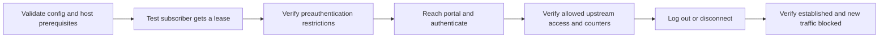

# IronGate setup and behavior verification

IronGate should explain the intended deployment, the host changes it requires, the client behavior it observed, and the reason a session or packet was allowed or denied. These capabilities are product requirements alongside forwarding correctness. The commands below are proposed interfaces, not implemented utilities.

## Configuration and setup

Use one versioned, typed TOML configuration as the source of truth. Separate a short common profile from advanced settings. Require explicit subscriber and upstream roles, client subnet, DHCP ownership, portal/provider contract, capacity budget, failure policy, and RADIUS endpoints/secret references only when selected. Derive redundant values where possible and display the effective configuration with provenance for defaults. Reject unknown or incompatible settings and point to the exact field and correction. The [CLI contract](cli-contract.md) defines text and JSON output, exit codes, candidate edits and the inspection/plan/apply workflow for operators, scripts and AI agents.

Keep essential behavior in the normal build rather than requiring operators to discover compile-time feature combinations. Report the binary's version, config schema and backend capabilities. Optional platform features must have explicit availability and startup checks.

Offer separate quickstarts for [standalone and centralized authentication](authentication-radius.md). Make RADIUS optional and show it as disabled when not selected. [VLAN network profiles](vlan-networks.md) each declare their own portal, provider, accounting destination and limits. Diagnose the selected network rather than treating all clients as one global configuration. Document [capacity calculations and scale profiles](deployment-scaling.md) alongside configuration examples.

Support managed mode, where IronGate creates a bounded set of named host resources, and preconfigured mode, where the administrator owns them and IronGate validates prerequisites. Do not silently choose between those modes. Separate management connectivity from subscriber interfaces, and identify conflicts with NetworkManager, systemd-networkd, bridges, VLANs and other services.

| Proposed command | Operator outcome |
| --- | --- |
| `ig init --output irongate.toml` | Generate a commented TOML profile without changing networking; guided setup requires an explicit interactive option |
| `ig config check --config irongate.toml` | Schema, cross-field, capacity and supported-feature validation |
| `ig doctor --config irongate.toml` | Read-only host and dependency preflight with actionable findings |
| `ig plan --config irongate.toml` | Exact owned resources and host changes needed, including management-path impact |
| `ig apply --plan setup.json` | Explicit privileged application after revalidating the saved plan against current host state |
| `ig status --json` | Separate process health, dependencies, enforcement readiness, capacity and recent failures |
| `ig session explain --client CLIENT` | Current state, matched policy, reason, pending request, limits and relevant transitions |
| `ig verify --config irongate.toml` | Explicit active verification through a test subscriber, with per-stage results |
| `ig support export --output report.json` | Size-limited diagnostic report with secrets and subscriber identifiers redacted by default |

Names and flags are design proposals. Add an operator crate only when implementing the first useful commands. Configuration checking and doctor should be usable before the daemon is installed or running.

Host preflight checks interface identity and ownership, link state, addresses and routes, privilege/capability requirements, socket conflicts, DHCP ownership, DNS and portal reachability, RADIUS configuration, MTU, clock health, and alternate bypass paths. A UDP endpoint being reachable does not prove that credentials, authenticators or accounting work. Inspection may be unavailable or incomplete under limited privileges; report that distinction.

## Evidence and error reporting

Each check reports a stable machine-readable code, severity, observed value, expected condition, next action and evidence timestamp. Distinguish pass, fail, warning, unsupported and unverified. Specify CLI exit codes for automation. A timeout or unavailable observation must not become a successful check.

Process health means that the process is responding. Enforcement readiness means required policy and interfaces are installed and fail-closed conditions hold. Dependency status reports DNS, portal and RADIUS separately. A degraded dependency does not imply restarting a healthy daemon; configured outage policy determines service behavior. End-to-end verification is a separate result requiring an independent subscriber vantage point.

Example session explanation:

```text
Client: <test client>
State: preauthentication
Decision: deny
Reason: authentication_required
Matched policy: subscriber_default
DHCP lease: assigned
Portal access: allowed by explicit exception
RADIUS request: no request pending
```

Bound event history per session and use stable reason identifiers. Keep observability outside the packet-processing allocation path. Explain IPv4/IPv6, protocol and garden exceptions explicitly rather than showing one ambiguous online flag. Logs must omit shared secrets, passwords and reusable challenges.

Make [accounting and throughput diagnosis](accounting-diagnostics.md) part of normal `ig doctor` operation. A per-client report should align traffic measurements with effective limit sources, queue/drop reasons and RADIUS update health. Show whether usage is measured before or after shaping and explain what the available evidence cannot establish. Default doctor queries existing observations; active probes belong in explicit verification commands.

## Independent client verification



Run a controlled probe from a network namespace or a separate test device attached to the subscriber path. Same-host HTTP requests cannot prove subscriber forwarding or switch/AP isolation. Test DHCP, DNS, garden exceptions, portal discovery, login, bidirectional traffic, accounting, quotas, shaping, and revocation, including existing flows. Verify IPv6 containment for an IPv4-only profile. Active checks must identify the test client and their traffic/session side effects.

Do not claim transparent HTTPS interception. Explain which portal discovery method or HTTP redirect is being tested. Keep optional external service failure scenarios repeatable in the lab. Report any topology component outside the probe's scope as unverified.

## Issue derived acceptance cases

These reports are examples of operator-visible failure classes, not a statistical survey or verified root-cause findings.

| CoovaChilli report | IronGate acceptance requirement |
| --- | --- |
| [Missing TUN device after setup, issue 543](https://github.com/coova/coova-chilli/issues/543) | Preflight identifies the required packet backend and missing resource, with the responsible setup step |
| [Captive portal not enforced, issue 334](https://github.com/coova/coova-chilli/issues/334) | Independent subscriber verification detects unauthorized access and alternate forwarding paths |
| [Login succeeds without usable connectivity, issue 500](https://github.com/coova/coova-chilli/issues/500) | Authentication, policy installation, DNS and upstream connectivity have separate evidence and status |
| [DHCP gateway forwarding problem, issue 65](https://github.com/coova/coova-chilli/issues/65) | Configuration declares DHCP ownership and supported topology; relay behavior is tested if supported |

Choose a measurable setup target during discovery, such as successful fresh-host installation by an operator following only the quickstart. Capture each support case as a reproducible diagnostic fixture or integration scenario before closing it.
