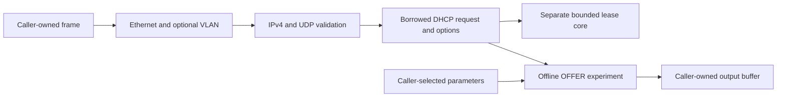

# Offline protocol pilot

`irongate-proto` now implements a narrow Ethernet/IPv4/UDP/DHCP input path and direct-client OFFER/ACK/NAK encoders. It remains `no_std`, forbids unsafe code, imports no allocator, and has no runtime dependencies. Its examples/tests use the workspace core as a development dependency. This is a protocol experiment, not a DHCP server: lease ownership now lives in the separate [offline lease core](lease-core.md); there is no active address conflict detection, session policy, socket, forwarding adapter or daemon integration.

## Data flow and ownership



`parse_request(&[u8])` returns a validated `RequestFrame` borrowing the original payload and option bytes. Small address/identifier fields are copied by value. No packet-sized scratch buffer, collection or string is created. Typed request constructors enforce invariants; the infallible option iterator is available only after a complete bounded validation pass. Lower-layer parsers are independently usable.

`dhcp::encode_offer` takes a validated request, caller-selected `Offer` parameters and a mutable output slice. It calculates capacity and validates its supported request/parameters before writing. Failure leaves the output unchanged. Success returns the used length and leaves remaining capacity untouched. The encoder does not select or reserve an address, validate deployment subnet policy or authorize a client. Network identity must eventually include the ingress interface and VLAN; neither a client MAC nor transaction ID establishes trust.

## Supported input and bounds

| Boundary | Supported form or limit |
| --- | --- |
| Frame | Ethernet II without FCS, at most 2048 bytes including padding |
| VLAN | Untagged or one inline 802.1Q tag, VLAN 1–4094; preserve full TCI |
| IPv4 | 20-byte header, nonzero TTL, valid total length and header checksum; DF accepted |
| UDP | Exact UDP/IP payload length agreement; present checksums verified, absent IPv4 UDP checksum reported explicitly |
| DHCP | BOOTREQUEST, Ethernet hardware type and six-byte unicast/nonzero chaddr, direct client ports 68 to 67 |
| DHCP bytes | At most 1472 payload bytes and 1024 bytes in the options region |
| Options | At most 64 non-PAD options; END required, only zero padding after END |
| Client types | DISCOVER, REQUEST, DECLINE, RELEASE and INFORM structurally parsed; lease command classification is separate from structural parsing |

Input outside the supported protocol forms returns `Unsupported`; this need not imply a malformed packet. IPv4 options, fragments, IPv6, stacked/service tags, priority-only VLAN tags, relays (hops/giaddr/option 82), DHCP option overload and newer message types are outside the pilot. Ethernet bytes beyond IP total length are ignored as padding, within the frame cap. Checksum offload metadata and hardware-stripped VLAN tags require a future adapter; raw captures with incomplete offloaded checksums are not automatically accepted.

Message type must be the first non-PAD option. Duplicate message type, requested address, server identifier, maximum size, client identifier or parameter request list options are rejected; interpreted values have explicit length checks. Unknown options are exposed individually in wire order without semantic validation or RFC 3396 concatenation. Do not treat the first raw value of a repeated unknown option as a complete logical option. Reserved DHCP flag bits are rejected as a deliberately strict pilot policy.

The OFFER encoder handles only DISCOVER with zero IP source and ciaddr. It broadcasts to Ethernet/IPv4 broadcast addresses, preserves inline VLAN TCI, echoes xid/chaddr and optional client identifier, emits message type/server ID/lease/subnet/router/DNS, and pads DHCP to at least 300 bytes. It computes IPv4 and UDP checksums, encoding a computed zero UDP checksum as `0xffff`. Output is 342 bytes untagged or 346 tagged for the normal fixture; a maximum-length client identifier increases this to 573/577 bytes. This fixed option subset does not fulfill every possible parameter request. The new ACK/NAK APIs and renewal delivery rules are documented in the [lease foundation](lease-core.md). Relay replies and boot options remain unimplemented; the OFFER API remains broadcast-only.

Protocol references: [DHCP](https://www.rfc-editor.org/rfc/rfc2131.html), [DHCP options](https://www.rfc-editor.org/rfc/rfc2132.html), [UDP](https://www.rfc-editor.org/rfc/rfc768.html), [IPv4](https://www.rfc-editor.org/rfc/rfc791.html), and [client identifier echo](https://www.rfc-editor.org/rfc/rfc6842.html). The limits and explicit exclusions above are IronGate pilot choices, not claims of full RFC conformance.

## Corpus and verification

The readable hex fixtures in `crates/irongate-proto/tests/fixtures` are synthetic packets with documentation addresses and locally administered MACs. `python3 scripts/generate-protocol-fixtures.py` reproduces them using Python's standard library and independent checksum/encoding code. Fixtures cover DISCOVER, absent UDP checksum, a tagged client identifier, REQUEST and expected untagged/tagged OFFERs, plus the new lease phases and ACK/NAK replies described in the lease document. They are not captured CoovaChilli behavior or evidence of interoperability.

Tests compare output bytes with those independent expected frames, exercise every truncated frame prefix, mutate bytes, verify odd-length checksums, preserve borrowed pointer identity, reject malformed/duplicate/unsupported options, and test exact/full/over-capacity boundaries. Mutation sweeps are regression tests, not coverage-guided fuzzing. Production qualification still needs fuzzing, differential parsing and VM interoperability.

```sh
just check
just protocol-allocations
```

The optional allocation check builds a release replay example and uses system Valgrind; Python and Valgrind are development tools, not Rust dependencies. Both measured processes perform identical fixture decoding and one warmup, then zero or 100000 tagged DISCOVER/OFFER replays. Equal aggregate allocation/free/allocated-byte totals demonstrate no additional measured heap activity for that replay workload. `black_box` prevents the replay and result from being discarded. On the initial PC run, both processes reported 17 allocations, 15 frees and 3741 bytes total, all in setup/runtime. This is not a throughput benchmark, session-churn test, arbitrary-input allocation proof, or a kernel/RSS memory guarantee. The normal test suite does not require Valgrind. The recipe honors `CARGO_TARGET_DIR`; for a target directory set through Cargo config instead, pass the resulting binary path directly to the Python checker.

## Dependency decision and next work

Initial documentation review found [etherparse](https://docs.rs/etherparse/latest/etherparse/) offers borrowed slices and allocation-free packet handling, [edge-dhcp](https://docs.rs/edge-dhcp/latest/edge_dhcp/) exposes DHCP packet/options and client/server modules, and [dhcproto](https://docs.rs/dhcproto/latest/dhcproto/) provides broad DHCP support with a documented owned/Vec encoding example. These are candidates, not rejected libraries. This pilot deliberately implements only a small bounded experiment; no full source, allocation, license or interoperability audit of those candidates has been completed. Avoid extending this into a general packet stack before comparing the candidates against the concrete acceptance corpus.

The [offline Coova comparison](coova-comparison.md) now provides differential option/OFFER cases, independent Python wire validation, sanitized original C execution and separate timing/allocation evidence. Offline lease ownership and ACK/NAK are now implemented with independent fixtures; equivalent C lease/reply comparisons, portal/session admission behavior and existing packet-library interoperability are still outstanding. Next add independent session/admission ownership and bounded effects, coverage-guided fuzzing, and ratify the lab's numerical targets. Add a disposable VM topology before any live DHCP exchange. Keep the dev PC's interfaces, routes and firewall untouched. Custom allocators are unnecessary for this slice; allocator-aware arenas remain a possible control-plane experiment under the Rust 1.100 baseline.
