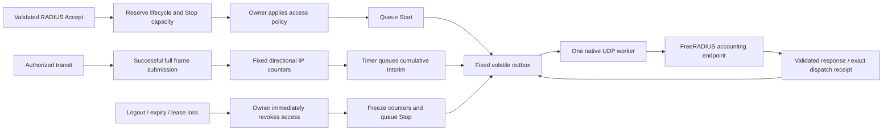

# Bounded RADIUS accounting in the isolated lab

The accounting feature adds real Start, Interim-Update and Stop export to the HTTPS/RADIUS lab. It is the second of the three [lab-alpha increments](lab-alpha.md). Run `just vm-accounting-test` after preparing the image with `just vm-radius-prepare`. QEMU has no external NIC, shared host filesystem or host network configuration changes. The original `just vm-radius-test` remains an authentication-only regression.

## How the critical path works



The single packet owner reserves accounting storage before accepting the grant, then activates Start only after policy application succeeds. It counts only successfully submitted transit IP octets in [the adapter](../crates/irongated/src/lab/io.rs). It never performs RADIUS I/O, waits for an acknowledgment, formats an accounting packet or allocates an accounting record in the packet loop. The [outbox](../crates/irongated/src/lab/accounting/outbox.rs), [scheduler](../crates/irongated/src/lab/accounting/scheduling.rs) and [receipt handling](../crates/irongated/src/lab/accounting/delivery.rs) have separate responsibilities.

Logout, authorization expiry and lease loss remove admission immediately and freeze the final counters. Delivery can fail while access revocation succeeds. Start must be acknowledged before this lifecycle's updates/Stop are exported. An unsent Interim may be replaced by a newer cumulative snapshot or final Stop; an unacknowledged Start or Stop is retained. A delayed result cannot acknowledge another lifecycle or free its storage.

## Bounds and failure policy

| Resource / behavior | Current lab bound |
| --- | --- |
| Retained lifecycles | Four fixed slots, each reserving Start, one replaceable Interim and Stop |
| Active subscriber | One; ended lifecycles can remain pending across reauthentication |
| Worker and channels | One accounting worker, one dispatch cell, one receipt cell, one dispatch in flight |
| UDP exchange | One send, one-second response budget, receive waits at most 150 ms and at most 64 receives |
| Retry scheduling | Per-lifecycle backoff 2, 4, then 8 seconds; attempts continue at that bounded rate while obligations remain |
| Interim scheduling | Monotonic timer, independent of traffic; missed intervals coalesce without a catch-up flood |
| Storage | Fixed in-memory records; no persistent replay or crash-complete Stop guarantee |
| Capacity/unavailable sink | Pause new accounting-dependent grants; existing grants retain their normal limits; logout still works |
| Stalled worker | Visible after three seconds; no second dispatch bypasses the outstanding receipt |

The owner reports its compiled outbox size in `memory_bytes`. This excludes thread stacks, service/socket buffers and HTTP reply storage. Fixed storage bounds fragmentation in the accounting owner; it does not establish an allocation-free process or a production capacity figure. The separate local journal still retains 16 rows and can independently pause admissions; accounting acknowledgments do not free those local rows.

Session IDs combine a random 128-bit boot identity, lab network ID and checked, nonwrapping lifecycle serial. Each authentication gets a new ID, including reauthentication of the same lease/session handle. The wire identifier is only an eight-bit transaction field; exact owner dispatch tokens use a wider sequence and lifecycle identity. Each dispatch uses the sequence's low byte for its wire identifier, with a fresh connected UDP socket. Delayed critical retries carry increasing Acct-Delay-Time and a newly computed authenticator. Backends must interpret cumulative snapshots and deduplicate retries rather than summing them as additional usage.

## Counter definition and wire profile

`input` means subscriber to upstream, mapping to Acct-Input-Octets/Gigawords. `output` means upstream to subscriber. Internal values are 64-bit; low and high 32-bit words are exported separately. Overflow saturates and is explicitly flagged locally. A new lifecycle resets its totals. Native HTTPS/RADIUS traffic, ARP, policy-denied packets and failed transmit submissions do not count. IP headers and retransmitted transit packets do count. Socket submission does not prove remote delivery or application goodput.

The worker uses RFC 2866 Accounting-Request/Response authenticators and RFC 2869 Gigawords, reusing the existing RustCrypto MD5 implementation and constant-time comparisons. No new Cargo dependency was added. This narrow interoperability profile accepts an empty Code 5 response with the matching identifier and valid response authenticator; unsupported response attributes are rejected. Accounting does not reuse Access-Response Message-Authenticator validation rules.

Packets carry the bounded authenticated User-Name, NAS identity/address/port, client address/MAC, accounting session ID, RADIUS authentication provenance, status and delay. Updates/Stop add cumulative usage and session duration; Stop adds termination cause. Passwords and the shared secret never enter owner messages. Usernames are retained only as bounded accounting identity; public status and exported test reports omit them.

## Explicit lab configuration

Add these settings to the existing native lab HTTPS/RADIUS TOML:

```toml
accounting = "radius"
accounting_endpoint = "192.0.2.80:1813"
accounting_interim_seconds = 2
```

Accounting requires the RADIUS authentication provider and reuses its secret file and NAS identifier. All three accounting fields are required together; the endpoint is restricted to the owned guest backend. Unknown, partial or conflicting settings fail startup. Absence of the fields preserves authentication-only behavior. One to sixty seconds is a **lab testing range**, not a production interval recommendation. No Acct-Interim-Interval policy attribute is accepted from the authentication server in this profile.

## Passive observations and evidence

Portal `/status` reports authentication and accounting separately. Accounting reports unknown/responsive/unavailable/stalled state, retained capacity, pending work, in-flight state, oldest pending snapshot age, outage duration, attempts/failures, invalid replies, stale receipts, send lag and validated-response age. Current, last exported and last acknowledged counters include their external session IDs; exported/acknowledged snapshots also identify their record kind. Compare matching identities and count points before diagnosing discrepancies. Coalescing can refresh the pending snapshot's age; outage duration remains separate.

An acknowledgment establishes a validated protocol reply. It does not prove fsync at the backend or correct downstream billing. Status explicitly reports backend billing and remote delivery as unverified, storage as memory and crash replay as false. `ig doctor` runtime integration belongs to the final alpha increment; this status endpoint is not yet that CLI command.

The schema-6 `radius-accounting-v1` fixture adds five accounting cases to eleven packet/guard and two HTTPS cases, for **18 live scenarios**. A real FreeRADIUS detail sink provides independent Start/Interim/Stop identity and cumulative totals. A paced approximately 64-kbit/s upload and larger reverse burst establish known totals of 65,792 input and 314,368 output IP octets. Idle updates prove timers work without subscriber traffic and native TLS/status traffic is excluded. A guest-only rule drops accounting responses while authentication remains available: Stop stays pending, new admission gets HTTP 503, logout revokes immediately, and restored replies drain the retained obligation. A second authentication must use a new backend session ID.

Pure/anonymous-socket tests cover ordering, capacity and Stop reservation, backoff, coalescing, stale receipts, slot/handle reuse, authorization expiry, failed submissions, saturation and values above 4 GiB. Independent Python/hashlib request/response vectors include malformed headers with valid authenticators, so cryptography cannot mask missing structural checks. Live guest execution is functional evidence, not merged into ordinary LCOV or proof of scale performance.

## Remaining line

This completes the accounting behavior for the selected lab profile once its clean-commit evidence passes. Finish operational/demo integration next, then stop alpha feature expansion. Durable outage/restart replay, shutdown draining, accounting failover, backend billing reconciliation, production transport/certificates, two VLANs/cloud and load/churn/soak qualification remain later work. A killed daemon can lose pending accounting work; the independent nftables guard still closes transit. Do not deploy this lab adapter as a production billing gateway.

References: [RFC 2866](https://www.rfc-editor.org/rfc/rfc2866.html), [RFC 2869](https://www.rfc-editor.org/rfc/rfc2869.html), [diagnostic design](accounting-diagnostics.md).
