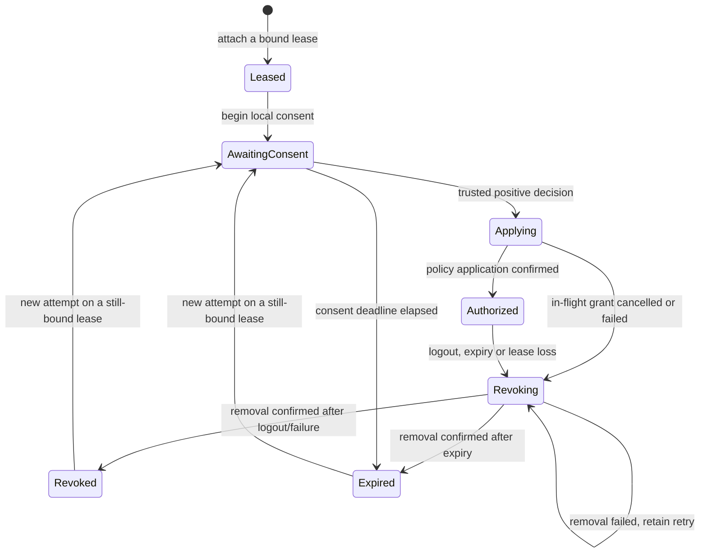

# Offline session and admission foundation

The session owner in `irongate-core` builds on the [lease foundation](lease-core.md). It borrows fixed startup-owned slots, observes the lease owner's monotonic clock, and keeps consent separate from address ownership. It has no runtime dependencies, allocator import, unsafe code, sockets, HTTP service or platform policy implementation.

```sh
just session-demo
```

The walkthrough uses a **simulated policy worker**: a leased client stays denied through consent and policy dispatch, becomes authorized after application acknowledgement, then is denied immediately on logout. A failed removal retains cleanup; a successful retry closes the session. A second admission demonstrates timeout and cleanup. This is a state-machine demonstration, not real traffic enforcement or a captive portal.

## State and authorization



Only `allows(leases, session)` is an access decision. It requires the matching lease arena and observed clock, a current bound lease generation, `Authorized` phase, and an unexpired access deadline. A `View` is the last observed diagnostic snapshot; it cannot authorize packets by itself. The owner must supply current monotonic time: these libraries do not read a clock themselves.

Logout/expiry can cancel an unsent grant without external work. Once a grant is dispatched, cancellation transitions to `Revoking`, retains the in-flight operation and waits for it to finish before dispatching removal. A late successful application cannot reauthorize a cancelled session. The diagram omits direct closure when no external operation was ever dispatched.

## Ownership and bounded effects

| Contract | Current implementation |
| --- | --- |
| Capacity | 1–256 caller-owned session slots per table/network; no growth or eviction |
| Session identity | Trusted network, unique owner epoch, slot index and non-wrapping generation |
| Lease identity | Exact bound lease handle, including its independent arena epoch/generation |
| Consent correlation | One current attempt; replacement invalidates earlier attempts; checked deadline and non-wrapping sequence |
| Effect capacity | Each occupied slot reserves capacity for one pending or in-flight operation; cleanup never competes for a separate queue |
| Dispatch | Round-robin bounded scan; at most one external operation in flight per session |
| Acknowledgement | Exact dispatched token; retries receive new sequences; stale/duplicate acknowledgements are rejected |
| Cleanup failure | Retain removal for retry, deny access, increment a saturating failure count, prohibit freeing the slot |
| Slot release | Explicit `forget` only after closure and completion of policy work; stale handles cease resolving |
| Address reuse | Reject attaching a new lease at an address whose older session still owns admission/cleanup work |

The table binds to one authoritative lease network/epoch. Keep the old lease/session owners available until cleanup is drained before replacing them. Reload, persistence and process-restart recovery are not implemented. Reconstructed owners need distinct nonzero epochs and an external deny-by-default guard. Sequence/generation exhaustion never wraps into an old identity.

Lease/address and session scans are linear, bounded by 256, with no production scaling claim. Full session storage returns an explicit error while existing sessions/effects continue. Closed diagnostic records occupy slots until forgotten; there is no hidden eviction or durable accounting journal. Actual slot size is target/build dependent; budget `size_of::<Slot>()` and surrounding buffers rather than assuming a fixed ABI.

## Owner loop and worker contract

1. Advance the lease clock using current monotonic seconds and retain its expiry effects.
2. Advance the session owner against that same lease table. It independently detects invalid/expired bindings and due consent/access deadlines.
3. Consume lease expiry/release/decline effects for the exact lease generation. Use `lease_lost` promptly after RELEASE/DECLINE and before further admission/reuse work. Synchronize again after lease mutations as needed.
4. Attach only a bound lease, begin explicit consent, then accept a trusted matching decision. The positive decision queues policy work; it does not authorize access.
5. Dispatch `take_effect(leases)`. It rejects an unobserved clock and rechecks a queued grant's lease/deadline. Removal remains available after the old lease disappears.
6. The worker applies the exact session/lease-scoped operation, then calls `complete` with its token and final result. Continue advancing time and servicing other clients while waiting.
7. Retry failed removals and free only closed sessions. Preserve failed/in-flight work in diagnostics; do not drop an owner to make capacity appear available.

Effects must be idempotent and acknowledgements must mean the operation is **finished and quiescent**. A timeout does not prove an asynchronous application stopped. Do not acknowledge still-running work, reorder effects, or allow background work to resume after reporting completion. Failed application may have partially changed policy, so the core always requires removal after it finishes. An operation that never completes retains its visible in-flight state and slot; worker watchdog/cancellation/restart behavior belongs to the future adapter.

The future packet owner must use current admission decisions, and the platform adapter must prove external enforcement closes on logout, expiry and process death. A core transition is not proof a kernel rule or wire path changed. Policy requests include an access deadline; the adapter must implement and verify it. An unknown application outcome must not be treated as successful admission.

## Consent and time policy

This slice implements trusted **local consent only**. It does not authenticate a person or process RADIUS credentials, provider responses or public HTTP callbacks. Attempts and effect tokens are predictable internal correlation values, not browser cookies, bearer tokens or cryptographic handoff credentials. The portal needs a secure, scoped handoff before accepting external input.

Access lifetime must be nonzero and within configured policy, and is capped by the current lease expiry at the positive decision. Renewal updates observed ownership but does not extend existing consent/access deadlines. A new attempt is required after cleanup. Consent timeout produces no external policy work; admitted timeout retains removal until acknowledged. These are explicit pilot policies, not a complete production/RADIUS policy model.

## Verification and quality checkpoint

```sh
just check
just comparison-check
just session-demo
just session-allocations     # Optional system Valgrind
just crap                    # Installed cargo-llvm-cov and cargo-crap
```

The initial feature run passed **113 workspace Rust tests**, including 21 new session tests, plus 16 comparison-framework regressions. Session cases cover grant acknowledgement, pending/in-flight cancellation, partial-apply cleanup, failed removal retries, stale identities, lease/access expiry, same-client network isolation, arena replacement, checked clocks/sequences, generation retirement, full-table pressure and address-reuse cleanup barriers. An exact 256-session case completes every removal obligation. These are deterministic regressions, not fuzzing or live enforcement evidence.

The release `session_replay` example uses fixed startup storage and a simulated worker. Both measured processes perform identical setup and one warmup, then zero versus 100000 extra cycles of lease binding, session attachment/reuse, replaced consent attempts, application/acknowledgement, alternating logout/expiry, failed removal/retry, stale acknowledgement rejection, forgetting and lease release. Initial Valgrind totals were **14 allocations, 12 frees and 4444 total allocated bytes in both processes**: zero additional measured heap allocation during those cycles. This does not measure throughput, all-input allocation behavior, RSS/kernel memory, actual workers or durable accounting.

The coverage-backed CRAP run analyzed **190 functions across 46 source files**, with all analyzed files matched to LCOV. The highest new session score was **12.0** (`Table::complete`, 100% reported line coverage). The CLI parser remains the only workspace function above the default threshold of 30. These are development-working-tree observations; collect fresh immutable evidence from the exact clean commit before launch. Full generated reports remain in `target/quality/`; the previous lease report was preserved locally in `target/quality/lease-checkpoint/`. Both are disposable, not the release archive. See the [release evidence contract](release-evidence.md).

## Next boundary

Next is the isolated Linux packet lab: one untagged client, real DHCP/ARP, native local service reachability, bidirectional userspace transit and independently observed unauthorized-drop/revocation/crash guards. Ratify the VM acceptance profile before treating load measurements as gates. Keep all links and mutations inside QEMU; this offline feature changed no host networking and did not boot or modify the VM.

The consent portal follows the enforcement proof. RADIUS authentication/accounting and external/cloud handoff then use the same admission ownership. No live policy adapter, accounting reservation/journal, HTTP service, secure portal handoff, provider integration or production qualification is included here. See the [MVP plan](mvp-plan.md).
