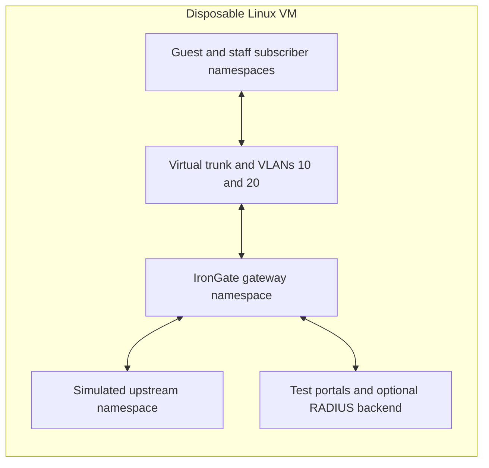

# IronGate development and isolated network testing

The configuration and passive doctor milestones can be built and tested on the development PC without changing its networking. Packet-level work should initially run inside a disposable Linux VM. Do not turn the developer's host into the test gateway or change its routes, bridges, firewall, sysctls, interface ownership or NIC settings as part of ordinary tests.

## Current tests on the PC

```sh
cargo fmt --all -- --check
cargo test --workspace
cargo clippy --workspace --all-targets -- -D warnings
cargo doc --workspace --no-deps
cargo run -p irongate-cli -- --config examples/standalone.toml config check --json
```

These tests compile code, read fixture files, invoke the CLI and create/remove their own temporary files. Doctor tests inject private filesystem fixtures; CLI doctor tests stop before host inspection on invalid config or unknown profiles. The test suite does not inspect host interfaces, bind ports, create namespaces, open network sockets or modify networking. References in example configurations are not dereferenced. Add `--offline` to Cargo commands when the locked dependencies are already cached.

An explicit `just ig doctor --host --json` reads real interface metadata from sysfs without loading TOML, privilege escalation or mutation. `just ig doctor --config PATH --json` additionally checks configured requirements. Use a configuration matching the desired inspection scope, and do not interpret a pass as gateway readiness. See [doctor](doctor.md) for limits. Host smoke checks are separate from fixture tests. Inventory fixtures cover inactive links with stale speed, unknown driver sentinels, missing/malformed speed and duplex, device classification, sorted bounded enumeration and independent inventory/preflight results.

The test suite verifies static profiles and CLI behavior, not gateway throughput or accounting delivery. A passing config report always leaves runtime readiness unverified. `irongated` still prints a scaffold notice and exits.

## Proposed packet lab inside a VM

Use a disposable guest with a snapshot and a dedicated virtual disk. Keep the lab disconnected from physical LAN bridges and passthrough NICs. Ordinary hypervisor NAT can provide optional build-time package access; the forwarding test topology remains entirely inside the guest. Installing or configuring a VM is a separate future action, not part of this milestone.



Linux namespaces and veth links can isolate the subscriber, gateway, upstream and service paths inside the VM. Creating those resources requires privileges/capabilities in the guest. Scripts must operate only on explicitly owned guest resources and clean up their own topology. They must never manipulate a host management NIC or default firewall rules.

First verify DHCP, different portals per VLAN, preauthentication restrictions, login, counters, limits and revocation. Then inject packet loss, slow/unavailable RADIUS, low-rate/high-load sessions, queue exhaustion and repeated churn. Capture diagnostic evidence and define expected findings. Network lab scripts and services are not implemented yet.

## Physical hardware qualification

Two physical NICs are not needed for initial software development. Later, use a dedicated gateway/test machine, suitable NICs and independent traffic endpoints to measure actual wire throughput, packet loss, driver/offload behavior, VLAN metadata and NIC tuning. Virtual results do not establish physical device capacity. Two dedicated ports are a straightforward lab topology; other arrangements require an explicitly tested deployment design.

Keep invasive NIC tuning, active load generation and gateway setup on that dedicated lab hardware or inside the VM. The first read-only host diagnostic command is available without needing that lab; active validation is still separate work.

Reference: [Linux network namespaces](https://man7.org/linux/man-pages/man7/network_namespaces.7.html) describes namespace isolation and veth links.
