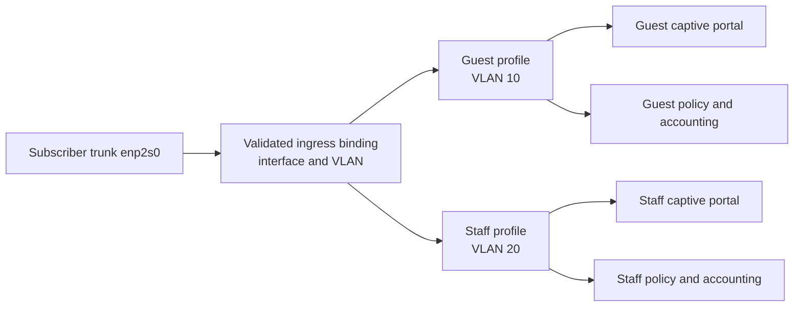

# IronGate VLAN network profiles

Support a distinct captive portal and access policy per VLAN on the same subscriber trunk. A network profile is the unit of configuration, session identity, accounting attribution and diagnostics. This is a first-release requirement, not an optional portal-only routing feature. No VLAN packet handling is implemented in the scaffold yet.

## Profile model

Each entry in `[[networks]]` has a unique name, subscriber interface, explicit tagging mode, optional VLAN ID, subnet, DHCP/DNS settings, portal contract, authentication provider, accounting destination, limits and session capacity. Named RADIUS pools can be shared without duplicating endpoint/secret definitions; each network explicitly references the pool it uses. A local provider is also valid for a VLAN profile.

The [VLAN example](../examples/vlan-portals.toml) gives guest VLAN 10 and staff VLAN 20 different external portals and explicit RADIUS/accounting selections. The [single-network](../examples/irongate.toml) and [standalone](../examples/standalone.toml) examples use the same schema with an untagged profile. All three pass the implemented static configuration checks; runtime VLAN/portal behavior remains unimplemented.

## Isolation and identity

Bind every session, lease, NAT/flow mapping, authentication challenge, provider event and accounting record to an immutable network identifier plus its live session generation. MAC or IP alone is not a unique session key across networks. The same device on two VLANs must have independent authorization and counters. Include the gateway/boot/session identity needed for globally unambiguous external records.

Classify ingress using the actual receiving interface and validated frame/adapter metadata. Do not let HTTP parameters, a portal hostname or a caller-supplied VLAN value choose authorization scope. Normalize hardware VLAN stripping and host VLAN subinterfaces behind the platform adapter. Return packets on the original profile's egress binding with correct tagging and MTU handling.

Portal callbacks and challenges must bind to the network/session they were issued for. A valid login or logout for guest cannot alter a staff session. Scope garden exceptions, DNS behavior, local services and control API lookups to the profile; sharing a portal host must not create a global exemption. The configured portal hostname selects the frontend experience, not authority over arbitrary subscriber networks.

Account for each network distinctly even when it shares an external RADIUS pool or local journal. Document NAS identity, NAS-Port mapping and supported VLAN attributes rather than assuming one universal server convention. Source identity and dynamic authorization matching must resolve an unambiguous network/session. RADIUS attributes cannot move a session to a different VLAN unless a separate reassignment feature is explicitly implemented and tested.

## Admission and configuration rules

Initially support one IEEE 802.1Q tag and explicit untagged profiles. Ordinary VLAN IDs are 1–4094; reject reserved VLAN 4095. Priority-tagged VLAN 0 needs an explicit supported mapping and must never silently become a tenant profile. Reject stacked tags/QinQ until support is implemented. The adapter must preserve enough metadata to detect unsupported forms.

Reject duplicate interface/VLAN bindings, ambiguous untagged profiles, invalid tags, missing portal/provider references, impossible capacity combinations and overlapping subscriber subnets that the selected routing backend cannot isolate. Initially require nonoverlapping managed subscriber subnets; VRF/namespace-based overlapping subnet support is separate scope. VLAN identity is scoped to the interface, not globally to a VLAN number.

Unknown VLANs and unmatched untagged traffic are denied on managed subscriber paths. No default portal or provider fallback is permitted. A deliberately configured untagged/native profile is an explicit exception. Document switch trunk/native VLAN configuration and verify it from an attached client; IronGate cannot infer or enforce all external switch behavior.

Reserve global capacity and enforce per-network ceilings so one busy VLAN cannot consume every session, packet or diagnostic resource. Define fair progress and bounded shaping queues across profiles without creating a thread per VLAN. Keep ingress classification and session lookups bounded, and benchmark many VLANs alongside many sessions.

## CLI and operational evidence

Proposed commands include `ig doctor --network guest`, `ig doctor --network staff --client CLIENT --window 60s`, and `ig session explain --network guest --client CLIENT`. JSON records include network ID/name, ingress interface, VLAN/tagging mode, live session ID, effective portal/provider and accounting destination. If a query is ambiguous across VLANs, return candidates rather than guessing.

Show per-profile readiness, DHCP/lease capacity, traffic, effective policy, accounting lag and dependency status. A failed guest RADIUS pool must not make an unrelated standalone staff profile unavailable. Global capacity pressure remains visible to every affected network. Reload and plan output identify affected profiles and whether changes revoke sessions or require reconnecting clients.

## Acceptance criteria

Use a trunk topology with two subscriber VLANs and independent probe clients. Verify different portal redirects, provider choices, garden rules, limits, leases, RADIUS/accounting attribution and revocation. Test the same MAC on both VLANs, swapped/replayed portal callbacks, forged network parameters, ambiguous administrative queries and delayed provider replies after session reuse.

Exercise unknown/native VLANs, stripped VLAN metadata, VLAN subinterfaces, invalid or stacked tags, VLAN MTU, cross-profile DNS/garden access and overload on one VLAN while the other retains service. Test return traffic tagging and containment across daemon startup/crash/restart. Benchmark profile lookup and diagnostic overhead at the declared network count. VLAN separation does not replace the AP/switch configuration or independent verification of the real subscriber path.
