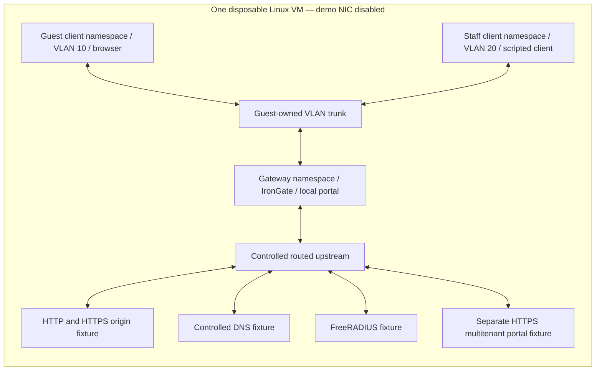

# Proposed isolated VM demonstration

Use **one disposable QEMU/KVM guest**, initially **4 vCPUs, 8 GiB RAM and a 32 GiB copy-on-write disk**, with Debian 13 and pinned package/image checksums. Debian 13 is the current stable release according to the [Debian release list](https://www.debian.org/releases/). This is a practical development allocation, not gateway capacity sizing. Validate KVM access/tool availability before provisioning; QEMU and a separate NIC-free packet lab are now implemented; no host networking is configured by the harness.

The [first QEMU lesson](qemu-first-boot.md) now provides image fetching, private overlay/seed preparation, command inspection and an offline serial-console launch. The tools are installed, KVM access works, and the pinned base/learning overlay have been verified through a real Debian console login and clean shutdown. The [one-client packet lab](linux-packet-lab.md) now proves real DHCP/ARP, native local TCP, bidirectional admission-gated transit and logout/expiry/crash guards. The full portal/RADIUS/VLAN demo below remains planned.

QEMU/KVM is the preferred boundary for this lab because the guest runs its own kernel; Docker containers share their host kernel, as explained in [Docker's VM/container comparison](https://docs.docker.com/get-started/docker-concepts/the-basics/what-is-a-container/). This lets us exercise guest nftables, routing, namespaces and failures without configuring the workstation network. Containers remain an option for packaging supporting services inside the guest, where their shared kernel would be the disposable guest's kernel.

Direct QEMU keeps the launch small and avoids a host libvirt bridge/network dependency. QEMU can explicitly start with `-nic none` to remove its default NIC, as documented in the [QEMU manual](https://www.qemu.org/docs/master/system/qemu-manpage.html). Build all test Ethernet links and VLANs inside the guest using namespaces/veth/guest bridges. The demo requires no physical two-port gateway and no host TAP, bridge, routes, firewall, DHCP, DNS or NIC changes.

## Guest topology

| Component | Proposed addressing / responsibility |
| --- | --- |
| Subscriber VLAN 10 | `10.50.10.0/24`, gateway `10.50.10.1`; guest profile |
| Subscriber VLAN 20 | `10.50.20.0/24`, gateway `10.50.20.1`; independent staff profile |
| Gateway upstream | `192.0.2.1/24`; lab services have explicit return routes via it |
| DNS / RADIUS / portal / web fixtures | `192.0.2.53`, `.10`, `.20`, `.80` in separately owned guest service namespaces |
| Client names/certificates | Guest-only DNS/host data and lab CA; separate trust/profile per browser client |

Documentation address ranges are real assigned addresses only inside this isolated lab. Guest root/admin capability creates the topology; privileges do not extend to changing the development PC. The script must verify its namespace/resource manifest before mutation and clean up only its own guest resources. Topology preparation and IronGate's persistent deny guard must have explicit ownership; tests must not rely on broad firewall flushes or global bridge defaults.

Keep subscriber and service namespaces separate from the VM management namespace. Do not give clients an independent default route, shared HTTP proxy or second NIC that bypasses IronGate. Each namespace uses its controlled resolver. All simulated Internet traffic terminates at fixture services; public Internet/NAT is not needed for the first result.

## Image preparation and repeatability

Prepare the guest once with system tools, build/test binaries, browser and pinned fixture packages. Optional package-download connectivity may use QEMU userspace NAT temporarily; it must stay outside subscriber/gateway namespaces and be disabled in the demonstration launch. Do not use bridged host networking. Retain a clean immutable base image and a fresh disposable overlay per run; copy artifacts out through an explicit non-network mechanism or an optional management-only connection that cannot reach subscriber paths.

Use a VM window/console to view the client browser, or a browser screenshot/video artifact. Start a separate browser process/profile inside the subscriber namespace; verify its network namespace. Do not reuse a browser already running in the VM management namespace, proxy client traffic through management, or use the development PC's browser for the authorization test. Those shortcuts could display the page without proving the subscriber path. The lab CA is trusted by guest clients only.

Record guest image digest, package manifest, Rust/C revisions, binary/config hashes, virtual CPU/memory allocation, run ID, topology, seed and active scenario. Keep generated secrets, certificates, disks, captures and reports under ignored development artifacts, with explicit redaction for exports. Snapshot reset should make repeated runs independent of earlier leases, portal cookies, sessions and RADIUS counters.

## Demonstration sequence

1. **Bootstrap:** start with one untagged client/profile to prove DHCP, ARP, DNS, host guard and return traffic. No portal UI dependency yet; an internal test authorization effect proves the real forwarding boundary.
2. **Local portal:** select `hosting = "local"`; obtain a lease, open the documented consent URL, show denied upstream access, accept, show allowed HTTP/HTTPS traffic and matching counters, log out and show both existing/new traffic blocked. Repeat expiry and process crash.
3. **RADIUS:** add a supported local HTTPS login mode through an explicit schema increment. Exercise accept/reject, timeout, invalid responses, Start/Interim/Stop and separate auth/accounting outage evidence. The backend remains an external service even when the portal page is local.
4. **External portal:** select `hosting = "external"`; serve the frontend from the separate HTTPS fixture namespace, with explicit tenant/site/gateway scope and a frozen versioned handoff contract. Gateway policy changes must follow verified provider decisions, not direct fixture manipulation.
5. **VLAN/tenant isolation:** use the trunk, with one local and one external portal and different content/policies. Then exercise a second tenant namespace at the shared external service. Reuse a MAC across VLANs, swap/replay callbacks and confirm that neither scope can authorize the other.
6. **Failure/load:** stop the portal, isolate RADIUS authentication versus accounting, fill pools/queues, delay replies and churn sessions. Add the paced low-rate client and bulk flows from the [MVP plan](mvp-plan.md); retain independent traffic/counter/diagnostic evidence.

Automatic CAPPORT discovery and a defined HTTP redirect path follow the explicit-URL walkthrough. HTTPS certificate warnings or spoofed external sites must never be presented as successful onboarding. A cloud-like service inside the guest makes outages and tenant isolation repeatable before testing a real remote service.

## Planned commands and evidence

Future development recipes should prepare an image, start a fresh overlay, build/reset the owned guest topology, run a named scenario and export an evidence bundle. Keep initial orchestration as small QEMU/guest scripts and `just` recipes; avoid Kubernetes, a container platform or a fleet orchestrator for this demo. The first one-client bootstrap recipes are now implemented as `vm-lab-prepare`, `vm-lab-command`, `vm-lab-check` and `vm-lab-test`; see the [packet lab](linux-packet-lab.md). Portal/RADIUS/VLAN scenario recipes remain pending.

Every scenario should report config/static checks, actual subscriber lease, portal location/reachability, provider decision, enforcement installation, before/after traffic, revocation, accounting acknowledgement/age and namespace identity. A page rendering or successful RADIUS response alone is insufficient. Reuse [comparison suites](comparison-framework.md) for deterministic protocol/state regressions and add a distinct live-scenario schema for end-to-end evidence; preserve their different scopes.

Virtual results establish the controlled behavior and regressions, not physical NIC throughput, Wi-Fi popup compatibility or production capacity. A dedicated two-NIC gateway and independent traffic endpoints remain later hardware qualification.
